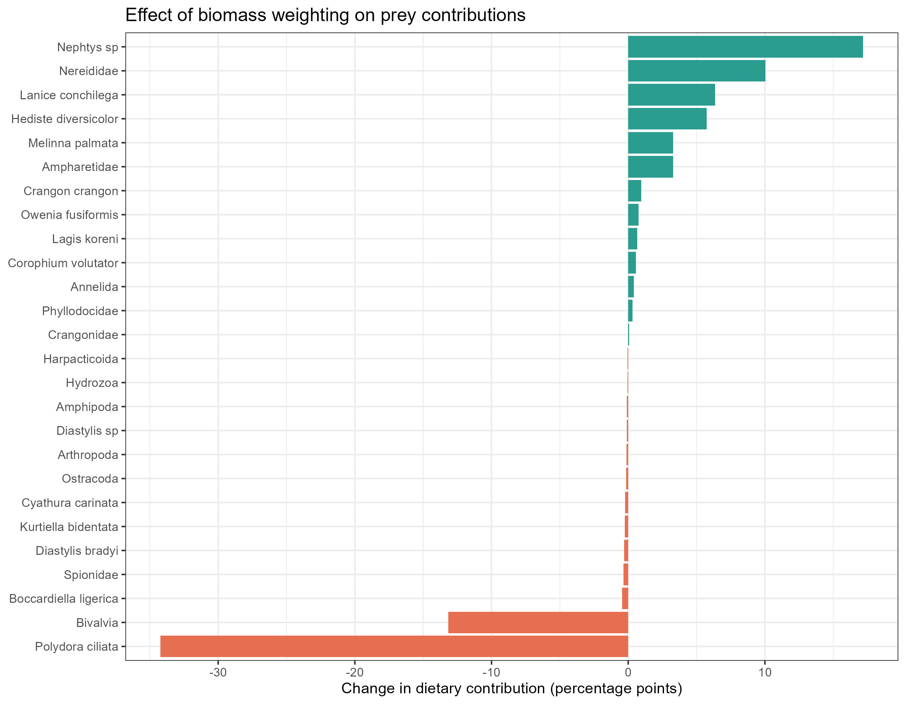
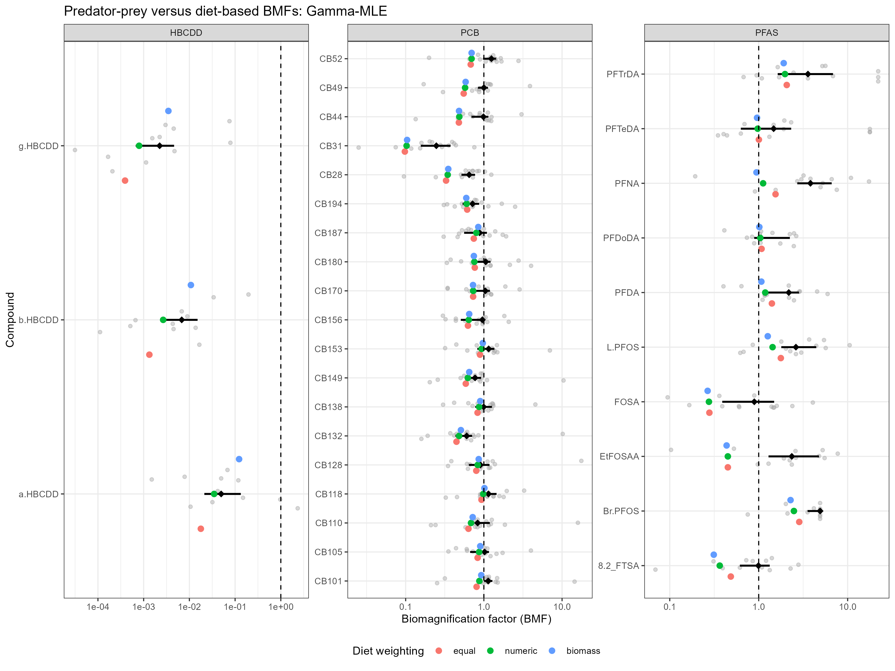
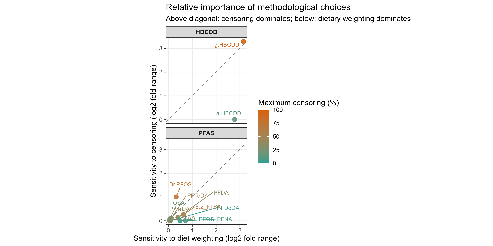

```{r setup, include=FALSE}
knitr::opts_chunk$set(
  echo = FALSE,
  warning = FALSE,
  message = FALSE,
  error = FALSE,
  fig.align = "center",
  fig.width = 7,
  fig.height = 5,
  out.width = "95%"
)

# Cross-document SI references are calculated from the SI chunk inventory.
# These are plain text refreshed on knit, NOT Word REF fields between documents.
source("SI_crossrefs.R", local = TRUE)
```

```{r packages}
library(chopin.BMF)
library(officer)
library(tidyverse)
library(flextable)
```


##### Abstract

Field-based biomagnification factor (BMF) estimates are commonly derived from normalised contaminant concentrations in predators and prey, although these concentration ratios do not necessarily represent contaminant enrichment relative to a physically reconstructed diet or directly quantify trophic transfer. Here, we investigated how dietary reconstruction and the treatment of left-censored concentrations influence field-based BMF estimates for polychlorinated biphenyls (PCBs), hexabromocyclododecane (HBCDD) isomers, and per- and polyfluoroalkyl substances (PFASs) in age-0 common sole (*Solea solea*) from the Seine estuary (France).

Contaminant concentrations in juvenile soles and 16 benthic prey species were combined with stomach content data to compare prey-specific and diet-based BMFs. Dietary contributions were estimated using equal, numerical, or biomass-based weighting, while four treatments of concentrations below quantification limits were evaluated: zero, half the quantification limit (LOQ/2), the quantification limit (LOQ), and gamma-based maximum-likelihood imputation (MLE), with lognormal MLE examined as a sensitivity analysis.

Dietary reconstruction substantially modified prey contributions: annelids represented 52.4% of prey individuals but 65.4% of estimated biomass, whereas molluscs accounted for 15.3% and 1.9%, respectively. Under the biomass-weighted gamma-MLE reference scenario, median BMFs were 0.719 for PCBs, 0.987 for PFASs and 0.011 for HBCDD isomers. The three HBCDD isomers were retained despite extensive predator censoring for β and γ; their analytical BMF upper bounds remained below unity in the archived autumn dataset. Under Q25, median and Q75 prey-mass scenarios, 3 of 32 compounds crossed BMF = 1. High censoring and reconstructed prey masses were therefore important, distinct sources of methodological sensitivity.

HBCDD isomers showed strongly contrasting quantification patterns between juvenile soles and benthic prey, with β- and γ-HBCDD frequently quantified in prey but rarely or never quantified in soles. These patterns were compatible with isomer-specific accumulation and bioisomerization processes reported in fish, although the extensive censoring of predator concentrations limited the interpretation of isomer-specific BMFs.

These findings demonstrate that methodological choices can substantially affect field-based normalised predator-to-diet concentration ratios, with compound-specific differences in their sensitivity. Ecologically informed dietary reconstruction and transparent treatment of analytical censoring are therefore essential for interpreting these operational BMF estimates, which should not be equated with measured contaminant intake or trophic transfer efficiency.

##### Keywords

Seine estuary; juvenile common sole; nursery habitat; PCBs; HBCDD; PFAS; dietary reconstruction; left-censored data

##### Highlights

- Dietary weighting strongly changes HBCDD field-based concentration ratios.
- Gamma- and lognormal-based imputations yielded similar BMF estimates.
- Compound-specific censoring audits clarify the limitations of MLE imputation.


\newpage

# Introduction

Coastal and estuarine ecosystems provide essential habitats for numerous marine fish species, particularly during their early life stages. Estuarine nurseries offer favourable conditions for feeding, growth and survival, thereby contributing to population recruitment and the renewal of exploited fish stocks [@beckIdentificationConservationManagement2001; @lepapeQuantitativeDescriptionHabitat2003; @rochetteEffectNurseryHabitat2010]. However, these habitats are also subject to intense anthropogenic pressures, including habitat alteration and chemical contamination, which may compromise their ecological functions [@halpernGlobalMapHuman2008; @halpernIndexAssessHealth2012]. Previous experimental and field studies have demonstrated that environmental degradation, particularly chemical contamination, can adversely affect juvenile fish growth, survival and physiological condition [@amaraGrowthConditionIndices2007; @gilliersAreGrowthDensity2006]. Understanding the mechanisms governing contaminant exposure and accumulation in juvenile fish is therefore essential for assessing the ecological quality and functioning of estuarine nursery habitats.

Among the numerous chemical substances released into aquatic environments, organohalogenated compounds (OHCs) are of particular concern because of their persistence, potential for bioaccumulation and toxicological effects. Estuaries are especially vulnerable to these contaminants, as they receive inputs from both upstream watersheds and local anthropogenic activities, while their hydrodynamic and sedimentary characteristics can favour contaminant retention and accumulation @ridgwayEstuariesRepositoriesHistorical2002. Once introduced into estuarine ecosystems, OHCs can become available to benthic organisms and subsequently be transferred to higher trophic levels through feeding interactions. Dietary exposure may therefore represent an important pathway of contaminant accumulation in juvenile fish inhabiting estuarine nurseries.

The trophic transfer of OHCs depends strongly on their physicochemical properties, environmental availability and interactions with biological tissues. Polychlorinated biphenyls (PCBs), per- and polyfluoroalkyl substances (PFASs) and hexabromocyclododecane (HBCDD) represent three major groups of contaminants exhibiting contrasting environmental behaviours and bioaccumulation mechanisms. PCBs are legacy pollutants characterised by high persistence and lipophilicity, favouring their accumulation in lipid-rich tissues and their transfer through aquatic food webs [@mackayBioaccumulationPersistentOrganic2000; @deribeBioaccumulationPersistentOrganic2011]. HBCDD, a brominated flame retardant, also exhibits persistent and bioaccumulative properties, although its environmental behaviour differs among stereoisomers. In particular, the α-isomer frequently predominates in aquatic organisms despite the γ-isomer being the major component of commercial mixtures @covaciHexabromocyclododecanesHBCDsEnvironment2006. In contrast, PFASs constitute a chemically diverse group of substances whose accumulation is not primarily governed by lipid partitioning but also involves interactions with proteins and other biological constituents. Several PFASs, particularly long-chain compounds such as perfluorooctane sulfonate (PFOS), have been shown to accumulate and biomagnify in aquatic food webs [@martinDietaryAccumulationPerfluorinated2003; @ahrensFateEffectsPoly2014]. These contrasting properties make the three contaminant families particularly relevant for investigating potential differences in trophic transfer and biomagnification.

Bioaccumulation reflects the net accumulation of a chemical in an organism through all exposure pathways, including water, sediment and diet. Biomagnification, more specifically, refers to an increase in contaminant concentration or chemical activity between a predator and its prey resulting from trophic transfer @gobasBioconcentrationBiomagnificationAquatic2000. Two commonly used metrics for investigating contaminant transfer through food webs are the biomagnification factor (BMF), which compares contaminant concentrations between a predator and its prey, and the trophic magnification factor (TMF), which characterises changes in contaminant concentrations across multiple trophic levels @fremlinGuidanceMeasuringEvaluating2025a. These metrics are widely used to assess the bioaccumulation potential of environmental contaminants and support chemical risk assessment. However, their estimation under field conditions remains challenging because of the variability in contaminant concentrations among organisms, differences in biological characteristics and the complexity of trophic interactions.

In field studies, BMFs are frequently estimated by calculating the ratio between contaminant concentrations measured in a predator and those measured in a potential prey species. Although straightforward, this prey-specific approach does not necessarily reflect the overall dietary exposure of predators consuming multiple prey types. In natural ecosystems, predator diets generally comprise several species that may differ considerably in their contaminant burdens and relative dietary contributions. Consequently, BMF estimates may vary substantially depending on the prey species considered. An alternative approach consists of estimating contaminant concentrations in the predator's overall diet by weighting prey-specific concentrations according to their relative contributions to food intake. Such an approach accounts for the composition of the prey assemblage consumed by the predator and may provide a more representative estimate of dietary contaminant exposure [@mackayBioaccumulationPersistentOrganic2000; @conderUseTrophicMagnification2012]. However, the extent to which incorporating dietary composition modifies BMF estimates, and whether this effect differs among contaminant families with contrasting bioaccumulation properties, remains insufficiently documented under natural field conditions.

Additional methodological challenges arise from the frequent occurrence of contaminant concentrations below analytical detection or quantification limits, particularly for emerging contaminants and compounds occurring at low environmental concentrations. The treatment of these left-censored observations can influence estimates of contaminant concentrations and, consequently, calculated BMFs. Similarly, interspecific variability in contamination levels, differences in tissue composition and the correspondence between predator and prey sampling may affect the interpretation of trophic transfer. Recent methodological recommendations have therefore emphasised the importance of appropriate data treatment, concentration normalisation and ecologically meaningful predator–prey relationships when assessing biomagnification in natural food webs [@fremlinGuidanceMeasuringEvaluating2025a; @conderUseTrophicMagnification2012]. These considerations are particularly relevant when comparing contaminant families with distinct physicochemical and biological behaviours.

The Seine estuary (France) provides a relevant case study for investigating these methodological issues. This highly anthropised estuary constitutes an important nursery habitat for the common sole (*Solea solea*), contributing to the Eastern English Channel stock [@riouRelativeContributionsDifferent2001; @rochetteEffectNurseryHabitat2010]. However, the Seine estuary has a long history of chemical contamination associated with industrial and urban activities throughout its watershed. Recent investigations have demonstrated that historical PCB and hydrocarbon contamination remains stored in estuarine sediments, which may act as secondary contaminant sources following sediment remobilisation @barrois_legacy_2026.

Previous investigations have documented the occurrence and environmental distribution of PFASs in freshwater systems within the Seine River basin, including the Orge River near Paris @labadiePartitioningBehaviourPerfluorinated2011 and the urban reaches of the Seine River @munozSpatiotemporalDynamicsPolyfluoroalkyl2018. At a broader geographical scale, HBCDDs and PFASs have also been detected in marine shellfish collected along French coasts @munschyLevelsTrendsEmerging2013. Together, these studies highlight the occurrence of these contaminants in regional freshwater and coastal environments, although they do not directly characterise contamination within the juvenile sole nursery investigated here. The combination of chemical contamination, diverse benthic prey communities and the ecological importance of juvenile sole makes this system particularly suitable for examining contaminant transfer through benthic food webs. Young-of-the-year common sole (age-0 individuals) are especially relevant because they occupy estuarine nursery habitats during a critical growth period and exhibit relatively limited movements between nursery grounds @riouRelativeContributionsDifferent2001.

The present study aimed to evaluate how methodological assumptions influence field-based biomagnification estimates of PCBs, HBCDD isomers and PFASs in age-0 common sole from the Seine estuary. Specifically, we aimed to (i) quantify the variability of predator–prey concentration ratios among benthic prey species, (ii) assess how numerical and biomass-based dietary reconstructions influence diet-based BMF estimates, (iii) evaluate the sensitivity of BMFs to different treatments of left-censored concentration data, and (iv) identify the relative importance of these methodological choices across contaminant families and individual compounds.


# Materials and methods

## Study area

The study was conducted in the Seine estuary, located along the French coast of the Eastern English Channel. This highly anthropised estuarine system drains a large and densely populated watershed characterised by extensive urban, industrial and agricultural activities. The Seine estuary has historically received chemical contaminants from upstream and local anthropogenic activities, resulting in the accumulation of persistent pollutants in estuarine sediments, particularly PCBs and hydrocarbons @barrois_legacy_2026.

Despite these anthropogenic pressures, the lower Seine estuary provides important nursery habitats for several marine fish species, particularly the common sole (Solea solea), whose juveniles use shallow coastal and estuarine habitats for feeding and growth [@riouRelativeContributionsDifferent2001; @rochetteEffectNurseryHabitat2010]. Benthic macrofauna constitute an important food resource for juvenile soles and a potential pathway for the trophic transfer of sediment-associated contaminants.

Common soles and benthic macrofauna were sampled during campaigns conducted in June and October 2017 within the juvenile sole nursery area. Sampling encompassed three main estuarine sectors: the northern pit (Fosse Nord), the southern pit (Fosse Sud), and the estuary mouth (Embouchure) (Figure \@ref(fig:fig-map)).

Because the limited number of predator and prey samples prevented reliable spatially or temporally resolved comparisons, samples from the different sectors and campaigns were pooled for analysis. The study area was therefore considered a single estuarine nursery system, acknowledging that this approach may overlook spatial and seasonal variability in contaminant exposure and prey availability.

```{r fig-map, fig.cap="Location of the study area in the Seine estuary (Eastern English Channel, France), showing the three sampling sectors: Fosse Nord (FN), Fosse Sud (FS), and Embouchure (EM) and corresponding sampling stations.", fig.dim = c(6, 3), fig.show='hold'}
knitr::include_graphics(
  system.file(
    "extdata",
    "map_seine.jpg",
    package = "chopin.data",
    mustWork = TRUE
  )
)
```

## Data sources and biological material

Data were obtained from the CHOPIN project, a multidisciplinary research programme investigating contaminant exposure and trophic relationships in juvenile common sole inhabiting the Seine estuary. The complete dataset, sampling procedures, analytical protocols and quality assurance procedures are documented in **Mounier et al., [YEAR]** and made available through the R package `chopin.data` (**[VERSION/DOI]**).

Three datasets were primarily used: `soles_contam`, containing contaminant concentrations in juvenile soles; `benthos_contam`, containing contaminant concentrations in benthic macrofauna; and `soles_stomach`, describing digestive tract contents. These were complemented by taxonomic, ecological and chemical metadata (`benthos_info`, `soles_info`, `species_classif` `contam_info`).

The source contamination dataset comprised ten age-0 common sole pools in the **autumn** chemistry subset and 50 benthic pooled samples representing 16 species (nine bivalves, five polychaetes and two crustaceans; `r si_ref("tab-benthos-species", "tab")`). The ten autumn sole pools were represented in each analysed contaminant family, while the number of available benthic analytical measurements varied by compound and family (`r si_ref("tab-censor-audit", "tab")`). Juvenile soles were analysed as whole-body pooled samples, with biometric characteristics, dry-matter content and total lipid content recorded. The archived sampling inventory should be reconciled with the original field records before submission.

Benthic macrofauna were collected using grab sampling and identified to the lowest practicable taxonomic level. Species were selected for chemical analysis based on previous dietary observations of juvenile common sole in the Seine estuary, including stomach content analyses reported in an unpublished Master's thesis @riusRepartitionRessourcesAlimentaires2009, and the availability of sufficient biological material. Taxonomic affiliation and feeding mode were recorded for each species.

The dietary composition of autumn G0 soles was independently characterised using digestive tract contents from individuals distinct from those used for chemical analyses (124 distinct sample identifiers in the archived inventory; confirm the number of biological individuals against source records).

Stomach-content samples and juvenile sole pools used for chemical analyses were collected in autumn, whereas benthic prey samples used for chemical analyses originated from both spring and autumn campaigns. Benthic samples from both seasons were retained to increase the number of chemically characterised prey samples and the taxonomic coverage available for dietary contaminant reconstruction. Consequently, predator and prey chemistry were not always temporally matched. The sampling inventory, including dates, seasons and available campaign information, is provided in `r si_ref("tab-sampling-inventory", "tab")`.


## Contaminant concentrations and censored data

Three families of organohalogenated contaminants were investigated: polychlorinated biphenyls (PCBs), hexabromocyclododecane isomers (HBCDDs), and per- and polyfluoroalkyl substances (PFASs). The analytical dataset included 19 PCB congeners, three HBCDD stereoisomers (α-, β- and γ-HBCDD), and 31 PFAS compounds, of which two were unavailable for the fish–prey comparison.

Chemical extraction, purification, instrumental quantification, method validation and quality-control procedures are described in **Mounier et al., [YEAR]**. Briefly, PFASs were extracted using methanol-based procedures, whereas PCBs and HBCDDs were extracted using organic solvents, followed by compound- and matrix-specific purification steps.

To account for differences in physicochemical properties and bioaccumulation behaviour of the targeted contaminants, concentrations were expressed using compound-specific normalisation approaches @conderUseTrophicMagnification2012. PCB and HBCDD concentrations were normalised to measured total lipid content and expressed as ng g⁻¹ lipid weight, reflecting their predominantly lipophilic behaviour. In contrast, PFAS concentrations were expressed on a dry-weight basis (ng g⁻¹ dry weight), as their accumulation is not primarily governed by neutral lipid partitioning and may involve interactions with proteins and membrane phospholipids. Alternative normalisation approaches based on specific biochemical constituents could potentially improve the comparability of concentrations among organisms, depending on the physicochemical properties of the compounds considered. However, information on lipid fractions, total protein content and albumin concentrations was unavailable because of insufficient sample material. The broader implications of concentration normalisation for field-based biomagnification assessments have already been discussed @fremlinGuidanceMeasuringEvaluating2025a.

Compound-specific limits of quantification (LOQs) were considered when processing concentration data. Concentrations below the LOQ were treated as left-censored observations. Censoring frequencies were calculated separately for juvenile soles and the pooled benthic prey dataset. Compounds with at least 80% censored observations in either juvenile soles or pooled benthic prey were excluded from the main PCB and PFAS analyses. The three HBCDD isomers were retained regardless of censoring frequency for a dedicated isomer-specific analysis, with heavily censored estimates explicitly identified and interpreted cautiously. This decision was motivated by experimental evidence of stereoisomer-specific accumulation and bioisomerization in fish, including the conversion of β- and γ-HBCDD into α-HBCDD [@lawHBCDBioisomerization2006; @duHBCDBioisomerization2012].

For retained compounds, four treatments of left-censored concentrations were evaluated: substitution by zero, half the LOQ (LOQ/2), the LOQ, and maximum-likelihood-based imputation (MLE) @borgaTrophicMagnificationFactors2012. Uncensored concentrations remained unchanged in all four scenarios. The primary MLE scenario used the gamma distribution; the corresponding lognormal imputation was retained for sensitivity analysis.

For model-based imputation, a gamma distribution was fitted independently to each compound-by-biological-group combination (juvenile soles or individual benthic prey species). This positive, right-skewed family was chosen as a pragmatic working assumption in view of simulation evidence of robustness to skewness and distributional misspecification [@gilliom_estimation_1986; @shoari_estimating_2015]; this does not establish that all measured concentrations follow a gamma distribution. Fitting was attempted only for groups with at least three observations, including at least two uncensored measurements, and strictly positive uncensored concentrations. Each censored measurement was imputed by the fitted conditional mean below its own LOQ. When the minimum requirements were unmet or the fit failed, LOQ/2 was used as a fallback. An otherwise identical lognormal MLE procedure was used to assess sensitivity to the parametric assumption. Fitting outcomes, fallback reasons and imputed values were audited at the compound-by-biological-group level (Supplementary Dataset S1).


## Dietary composition and prey biomass estimation

Dietary composition was reconstructed from digestive tract contents of age-0 common sole collected during the autumn sampling period. Prey abundance was determined from the total number of individuals identified in the stomach and intestine. Fish remains and prey taxa occurring in fewer than three soles were excluded from the analysis. Prey were identified to the lowest practicable taxonomic level and assigned to their corresponding taxonomic groups.

Two complementary approaches were used to quantify dietary composition: numerical proportions, based on prey abundance, and biomass-weighted proportions, accounting for differences in prey body mass.

Individual prey masses were estimated using the Btrait package (v1.0.1; [@soetaertBtrait2023; @beauchard_assessing_2023] and the dataset from @gogina_weight_weight_2022. For each reference species, ash-free dry weight (AFDW, mg ind⁻¹) was calculated by dividing biomass by abundance. Because these reference datasets include organisms sampled in the Baltic and North seas, the resulting mass estimates may not fully reflect the size distributions of prey consumed by age-0 common sole in the Seine estuary. They were therefore used as proxies for individual prey biomass rather than direct measurements of ingested prey mass.

When a species was represented in both datasets, the lowest median mass was retained to favour smaller prey sizes potentially more representative of G0 sole diets. When no species-specific estimate was available, prey taxa were matched to reference species at the most specific shared taxonomic rank. If several reference species matched at this level, the median of their median masses was used as the representative estimate (see Supplementary for taxonomic matching, data sources, and estimated individual ash-free dry weight (AFDW) of prey taxa identified in juvenile common sole digestive tracts).

For bivalves, estimated individual masses were multiplied by a factor of 0.0375 to approximate the contribution of siphonal tissues potentially consumed by juvenile soles. This factor was based on reported differences in relative siphon mass between *Scrobicularia plana* (5 %) and *Limecola balthica* (2-3 %) @zwarts_feeding_1994. Because species-specific estimates were unavailable for the other bivalves, the same factor was applied to all bivalve taxa as a simplifying assumption.


For each prey phylum $p$, numerical and biomass-weighted dietary proportions were calculated as:

$$P_{N_p}=\frac{\sum_{s}N_{p,s}}{\sum_{q,s} N_{q,s}}$$

$$P_{B_p}=\sum_p\frac{\sum_s{N_{p,s}M_{p,s}}}{\sum_{q,s}N_{q,s}M_{q,s}}$$

where $P_{N,p}$ and $P_{B,p}$ represent the numerical and biomass-weighted dietary proportions of phylum $p$, respectively; $N_{p,s}$ is the total number of individuals of prey taxon $s$ belonging to phylum $p$; and $M_{p,s}$ is the estimated median individual ash-free dry weight (AFDW) of that taxon. The index $q$ denotes all prey phyla considered in the dietary reconstruction.Dietary proportions were calculated from pooled stomach-content observations and subsequently aggregated at the phylum level (Annelida, Arthropoda and Mollusca). Numerical proportions included all recorded prey individuals, whereas biomass-weighted proportions were calculated only for prey taxa with valid individual mass estimates and normalised over the total estimated biomass of those taxa.

To assess the sensitivity of biomass-weighted dietary reconstruction to uncertainty in individual prey masses, the calculations were repeated using Q25 and Q75 mass estimates instead of median values. The corresponding biomass contributions were recalculated simultaneously for all prey taxa, using the same taxonomic subset across the three mass scenarios.

The three reconstructions represent deterministic sensitivity scenarios based on the available prey-mass estimates, rather than statistical confidence intervals. In particular, the lower and upper reference-mass estimates reflect the dispersion of literature-derived measurements and taxonomic matching uncertainty, rather than quantified uncertainty in the actual masses consumed by individual soles.

## Biomagnification factor estimation

Field-based biomagnification factor (BMF) estimates were calculated for individual compounds using two complementary approaches: predator–prey concentration ratios and predator-to-diet concentration ratios @schaferBioaccumulationAquaticSystems2015.

 Because predator and prey samples were not directly matched in space and time, and dietary composition was reconstructed from pooled digestive tract observations, these estimates represent integrated concentration ratios at the scale of the estuarine nursery system rather than direct measurements of contaminant transfer between confirmed predator–prey pairs. Throughout this study, the term “BMF estimate” refers to these operational concentration ratios. Values exceeding one indicate higher normalised concentrations in juvenile soles than in the corresponding prey or reconstructed diet, but do not, on their own, demonstrate trophic biomagnification or identify the mechanisms responsible for contaminant accumulation.


### Predator–prey BMFs

For each contaminant $c$ and benthic prey species $p$, the predator–prey BMF was calculated as:

$$\mathrm{BMF}_{p,c}=\frac{C_{\mathrm{sole}_c}}{C_{p,c}}$$

where $C_{\mathrm{sole}_c$ is the arithmetic mean concentration of contaminant $c$ in juvenile sole pools, and $C_{p,c}$ is its arithmetic mean concentration in prey species $p$.

Predator–prey BMFs were calculated separately for each censoring scenario. Their distributions were characterised using the median, interquartile range (Q25–Q75), and minimum and maximum values across prey species. Ratios exceeding one indicated higher concentrations in soles than in the corresponding prey, without necessarily demonstrating direct trophic biomagnification.


### Diet-based BMFs

Diet-based BMFs were estimated by incorporating the relative contributions of the main prey groups to the reconstructed diet of juvenile common sole. For each compound, arithmetic mean concentrations were first calculated within each chemically analysed benthic species and subsequently averaged across species belonging to the same phylum, assigning equal weight to each reference species.

The estimated dietary concentration of contaminant $c$ was calculated as:

$$C_{\mathrm{diet},c}= \sum_p w_p\overline{C}_{p,c}$$

where $\overline{C}_{p,c}$ is the mean concentration of compound $c$ in phylum $p$, and $w_p$ is its dietary weighting coefficient, with weights summing to one across the included phyla. Three weighting approaches were considered: (i) equal contributions of available prey phyla, (ii) numerical dietary proportions, and (iii) biomass-weighted dietary proportions.

The estimated dietary denominator represents a weighted arithmetic mean of normalised prey concentrations rather than the contaminant concentration of a physically reconstructed mixture of ingested prey tissues. Specifically, PCB and HBCDD concentrations were expressed on a total lipid-weight basis, whereas PFAS concentrations were expressed on a dry-weight basis. Dietary weighting coefficients were derived from prey abundance or estimated ash-free dry biomass and did not explicitly account for differences in lipid or dry-matter content among prey species. This approach was retained to ensure consistent comparisons among dietary weighting methods, while recognising that the resulting diet-based BMFs represent approximate field-based concentration ratios. Because dietary weighting coefficients were based on estimated prey abundance or ash-free dry biomass rather than on the actual lipid or dry-matter masses represented in the diet, the reconstructed dietary denominator should not be interpreted as the measured contaminant concentration of ingested prey tissues. Accordingly, the resulting field-based BMFs were used as operational normalised predator-to-diet concentration ratios, rather than estimates of ingested contaminant doses or trophic transfer efficiencies.

Diet-based BMFs were calculated as:

$$BMF_{\mathrm{diet},c}=\frac{\overline{C}_{\mathrm{sole},c}}{C_{\mathrm{diet},c}}$$

where $\overline{C}_{\mathrm{sole},c}$ is the arithmetic mean concentration of compound $c$ in juvenile sole pools, expressed on the same normalisation basis as the prey concentrations. All calculations were performed independently for each compound and censored-data treatment scenario. These ratios were used to compare the influence of alternative dietary reconstruction methods, rather than to quantify actual contaminant intake or trophic transfer efficiency.

### Comparison of BMF approaches and sensitivity analyses

The combination of four censoring treatments and three dietary weighting approaches produced 12 analytical scenarios per compound.

The influence of dietary weighting was first evaluated by comparing biomass-weighted and numerically weighted BMFs une the MLE censored-data treatment scenario. Relative differences were expressed as:

$$
\Delta_{\mathrm{weight}_{c}}(\%) =
100 \left(
\frac{\mathrm{BMF}_{biomass,c}}
     {\mathrm{BMF}_{numeric,c}}
- 1
\right)
$$
Positive values of $Δ_{weight}$ indicate higher BMF estimates under biomass weighting than under numerical weighting. 

The influence of dietary reconstruction was further assessed by comparing each diet-based BMF with the distribution of predator–prey BMFs for the benthic prey species $i$ obtained for the same compound and censoring scenario. Relative differences from the median predator–prey BMF were calculated as:

$$
\Delta_{\mathrm{approach}_{w,j,s}}(\%) =
100 \left(
\frac{\mathrm{BMF}_{w,j,s}}
     {\operatorname{median}
      \left(\mathrm{BMF}_{i,j,s}\right)}
- 1
\right)
$$
Positive values of $Δ_{approach}$ indicate higher diet-based BMF estimates than the median predator–prey BMF calculated across individual prey species.

The taxonomic correspondence between prey identified in digestive tracts and benthic taxa analysed for contaminants was also assessed, and the numerical and biomass contributions associated with directly matching and unmatched taxa were quantified (Supplementary Methods).

Sensitivity to censoring treatments was evaluated by comparing BMF estimates across the four scenarios. Log₂-transformed BMF ratios were used to describe proportional differences between weighting methods. Changes in the position of BMF estimates relative to the reference threshold of one were recorded to assess the stability of concentration-ratio interpretations across methodological scenarios.

An additional sensitivity analysis assessed the influence of the bivalve siphon-mass correction on biomass-weighted BMF estimates. The correction factor was varied from 0.02 to 0.05 (2–5% of estimated individual bivalve mass), encompassing the reference value of 0.0375. For each factor, the biomass-weighted dietary proportions and corresponding BMFs were recalculated with all other assumptions held constant, using gamma-MLE as the reference censored-data treatment. Literature-based Q25 and Q75 prey-mass assumptions were also examined separately to characterise uncertainty in dietary biomass composition (Supplementary Materials).

The sensitivity of biomass-weighted BMF estimates to literature-derived individual prey masses was evaluated using three alternative dietary reconstructions based on Q25, median and Q75 mass estimates. For each reconstruction, prey biomass contributions were recalculated simultaneously across all prey taxa, and the resulting phylum-level weights were propagated to the reconstructed dietary concentrations and field-based predator-to-diet concentration ratios.

For each compound, the sensitivity range was defined by the minimum and maximum BMF estimates obtained across the three mass scenarios, rather than by assuming that Q25 and Q75 masses necessarily produce the lowest and highest BMF values, respectively. 


$$BMF_{min} = \frac{C_{sole,min}}{C_{diet,max}}$$
$$BMF_{max} = \frac{C_{sole,max}}{C_{diet,min}}$$


A multiplicative sensitivity range was also calculated as the ratio of the maximum to the minimum positive BMF estimate, where defined. Changes in classification relative to a concentration ratio of unity were recorded.

These deterministic sensitivity ranges represent the consequences of alternative prey-mass assumptions, not confidence or credible intervals. Applying Q25, median or Q75 estimates simultaneously to all taxa does not propagate covariance among prey-mass estimates or provide probabilities for the occurrence of the resulting dietary scenarios.

A leave-one-chemically-analysed-prey-species-out analysis evaluated the influence of individual prey species represented in the contaminant dataset on reference diet-based BMF estimates. For each compound, one chemically analysed prey species was excluded in turn, mean prey concentrations were recalculated at the phylum level, and the biomass-weighted field-based predator-to-diet concentration ratio was recomputed under the reference gamma-MLE censoring treatment. Dietary biomass weights were held constant. If the deleted species was the only chemically characterised representative of its phylum, this phylum was omitted from the chemical denominator and the remaining dietary weights were renormalised. We recorded percentage changes in the estimated ratio, changes in classification relative to unity, and whether removal eliminated an entire chemically represented phylum. This diagnostic assesses the influence of species represented in the chemical dataset; it does not quantify uncertainty in the identities or abundances of prey ingested by soles.

Particular attention was given to compounds for which the alternative mass assumptions changed txhe position of the field-based concentration ratio relative to unity. All calculations were performed using the gamma-MLE censoring scenario, including LOQ/2 fallback when model fitting was not feasible, while keeping contaminant concentrations and the dietary taxonomic structure unchanged.

Contaminant concentrations were summarised by species using arithmetic means and standard deviations, and within-species variability was described using the coefficient of variation when at least two measurements were available. Differences among prey taxa and contaminant families were explored descriptively.

Given the unbalanced sampling design, limited replication for some prey species, and potential dependence among compounds within contaminant families, the analyses focused primarily on effect sizes and descriptive comparisons rather than formal hypothesis testing.

All data processing, calculations and graphical representations were performed using R @Rcoreteam primarily using tidyverse packages and explicit likelihood optimisation for gamma and lognormal censored-data models.

### HBCDD isomer-specific analysis under extensive censoring

The three HBCDD isomers were retained irrespective of their censoring frequencies to investigate isomer-specific differences in occurrence and field-based concentration ratios between juvenile soles and benthic prey. This exception to the general 80% censoring threshold was motivated by the marked differences in isomer-specific quantification frequencies between biological compartments and by experimental evidence that differential accumulation and bioisomerization can occur in other fish species [@lawHBCDBioisomerization2006; @duHBCDBioisomerization2012].

Quantification frequencies were calculated separately for each isomer and biological compartment. In addition to the four censoring treatments considered in the main analyses, analytical bounds were obtained by assigning censored concentrations their minimum possible value (zero) or their corresponding limit of quantification (LOQ), while preserving quantified measurements. These concentration bounds were propagated through the same species-level, phylum-level and dietary weighting procedures used for the BMF calculations.

For each isomer, the lower BMF bound was calculated as the ratio between the lower predator concentration bound and the upper dietary concentration bound. Conversely, the upper BMF bound was obtained using the upper predator concentration bound and lower dietary concentration bound. When the latter was zero, the upper bound was considered unbounded.

These bounds represent the range of field-based concentration ratios compatible with analytical censoring under fixed dietary reconstruction assumptions. They are not statistical confidence intervals and do not account for uncertainty in prey-mass estimates, taxonomic correspondence or environmental exposure. BMFs based predominantly on substituted concentrations were interpreted as exploratory estimates.


### Hierarchical assessment of methodological sensitivity

To compare the relative influence of dietary reconstruction and censored-data treatment on biomagnification estimates, a compound-specific methodological sensitivity analysis was performed. Sensitivity to dietary weighting was quantified as the log₂-transformed ratio between the maximum and minimum BMF estimates obtained across the three dietary weighting approaches, while keeping the censoring treatment constant. Conversely, sensitivity to censoring was quantified across the four censoring scenarios while keeping dietary weighting constant.

The log₂-based methodological sensitivity analysis was restricted to compounds with strictly positive and finite BMF estimates for all 12 combinations of four censoring treatments and three dietary weighting approaches. For each compound, the number of valid combinations and its eligibility for the logarithmic analysis were recorded, together with the reason for non-eligibility. The number of eligible compounds was summarised by contaminant family.

To complement this analysis and retain compounds yielding zero BMF values, a zero-compatible bounded sensitivity measure was calculated:

$$D=\frac{BMF_{\max}-BMF_{\min}}{BMF_{\max}+BMF_{\min}}$$

where $BMF_{\min}$ and $BMF_{\max}$ represent the minimum and maximum BMF estimates within the methodological approaches being compared. The index ranges from zero (identical estimates) to one (the minimum estimate is zero and the maximum is positive). When all estimates were zero, $D$ was set to zero by convention. The measure was calculated only for compounds with finite, non-negative BMF estimates across all 12 combinations.

Dietary-weighting sensitivity $D_{\mathrm{diet}}$ was calculated across the three dietary weighting approaches for each censoring treatment, whereas censoring sensitivity $D_{\mathrm{censor}}$ was calculated across the four censoring treatments for each dietary weighting approach. Compound-level sensitivities were then summarised using the median of the corresponding contrasts. The dominant methodological source was identified by comparing $D_{\mathrm{diet}}$ and $D_{\mathrm{censor}}$.

This complementary measure enabled the inclusion of compounds with zero BMF estimates without introducing arbitrary positive constants. Both sensitivity metrics were interpreted as deterministic measures of methodological dependence rather than statistical uncertainty estimates.

For each compound, the median sensitivity across censoring scenarios or dietary weighting approaches was used to characterise the respective methodological effects. Their relative magnitude was compared to identify the dominant source of methodological sensitivity. Analyses were restricted to compounds with positive, finite BMF estimates for all twelve combinations of censoring treatment and dietary weighting. Results were summarised by contaminant family and examined in relation to the maximum proportion of censored observations recorded in predator or prey samples. These comparisons were interpreted descriptively, as measures of sensitivity to analytical assumptions rather than estimates of statistical uncertainty.


# Results

## Dietary composition and the effect of biomass weighting

The reconstructed diet of age-0 common sole was dominated by annelids and arthropods, although the relative contributions of the main prey groups differed between numerical and biomass-based estimates (Fig. \@ref(fig:fig-prey-contributions)). Annelids represented 52.4% of total prey abundance, followed by arthropods (32.1%) and molluscs (15.3%), whereas cnidarians contributed less than 0.3%.

When prey contributions were weighted by estimated individual biomass, annelids became more dominant, accounting for 65.4% of total dietary biomass (+13.0 percentage points compared with numerical proportions). In contrast, the contribution of molluscs decreased markedly, from 15.3% of prey individuals to only 1.9% of estimated biomass (−13.4 percentage points). Arthropods contributed similarly under both approaches (32.1% numerically and 32.6% by biomass), while cnidarians remained negligible (0.2%).

At a finer taxonomic resolution, biomass weighting increased the relative contribution of several polychaete taxa, particularly *Nephtys* spp., Nereididae, *Lanice conchilega* and *Hediste diversicolor*. Conversely, the contribution of *Polydora ciliata* decreased substantially, despite its high numerical abundance. These contrasting responses indicate that biomass weighting altered not only the relative importance of major prey groups but also the contributions of individual taxa within annelids.

Overall, the strongest compositional change was a redistribution of dietary contributions from molluscs towards annelids, whereas the contribution of arthropods remained comparatively stable. These differences provided the basis for evaluating the sensitivity of diet-based BMF estimates to the method used to quantify prey contributions.

Taxonomic correspondence between prey identified in juvenile sole digestive tracts and benthic taxa analysed for contaminants was incomplete (`r si_ref("tab-diet-matching", "tab")`). Overall, taxa sharing an identical taxonomic designation with the chemical dataset accounted for 62.3% of estimated dietary biomass, including 36.3% contributed by annelids and 26.0% by arthropods. Within these two phyla, directly matching taxa represented 55.6% and 79.8% of estimated biomass, respectively. The remaining dietary biomass was associated with prey categories lacking an identical taxonomic designation, particularly annelids (29.0% of total dietary biomass). Molluscs and cnidarians collectively contributed only 2.1% of estimated dietary biomass and had no direct taxonomic matches. These findings highlight the partial taxonomic coverage underlying the phylum-level reconstruction of dietary contaminant concentrations.

```{r fig-prey-contributions, fig.cap="Changes in the estimated dietary contributions of prey taxa, identified to the lowest practicable taxonomic level,  when numerical proportions are replaced by biomass-weighted proportions in the diet of age-0 common sole (Solea solea) from the Seine estuary. Bars represent the difference in percentage points between biomass-weighted and numerical contributions (biomass minus numerical proportion). Positive values indicate a greater contribution to estimated dietary biomass than to prey abundance, whereas negative values indicate the opposite. Biomass proportions were calculated using literature-derived estimates of individual prey ash-free dry weight (AFDW), with a correction factor of 3.75% applied to bivalves to approximate the potentially ingested siphonal tissues.", fig.show='hold'}

```

## Predator–prey and diet-based biomagnification factors

Predator–prey BMF estimates varied considerably among benthic species for individual contaminants (Fig. \@ref(fig:fig-bmfs-diet)). For several compounds, the distribution of concentration ratios spanned more than one order of magnitude, indicating substantial variation depending on the prey species considered. Diet-based BMF estimates generally fell within the range of predator–prey ratios, although their position within this distribution differed among compounds and weighting approaches. The substantial variability in predator–prey BMF estimates was associated with marked differences in contaminant concentrations among benthic prey species (see Supplementary material for a representation of contaminant concentrations in juvenile sole and benthic prey). These differences were apparent within individual contaminant families and among species belonging to the same broad taxonomic group.

For PCB congeners, diet-based BMF estimates were relatively consistent among the three dietary weighting methods. HBCDD isomers exhibited contrasting patterns of quantification in juvenile soles and benthic prey, leading to substantial differences in the analytical support available for isomer-specific BMF estimates. α-HBCDD estimates were supported by quantified predator concentrations, whereas β-HBCDD estimates relied entirely on substitution of censored predator concentrations and γ-HBCDD estimates relied predominantly on such substitution. Consequently, point estimates for the latter two isomers were considered exploratory and interpreted alongside analytical BMF bounds. The resulting bounds were used to assess whether the position of each concentration ratio relative to unity was supported by the available measurements or depended on the assumed values assigned to censored observations (`r si_ref("tab-hbcdd-bounds", "tab")`). For the 10 retained PFAS, dietary-weighting effects were compound-specific, with several estimates above one. The direct contrast between numerical and biomass weighting is shown in `r si_ref("fig-diet-weighting-delta", "fig")`.

The sensitivity analysis of the assumed bivalve siphon mass indicated that biomass-weighted BMF estimates were largely robust to this methodological assumption (see Supplementary material). Varying the proportion of potentially ingested bivalve tissue from 2% to 5% had virtually no effect on PCB and PFAS estimates. In contrast, HBCDD BMFs decreased progressively as the assumed siphon mass increased, although the magnitude of these changes remained limited compared with the differences observed among dietary weighting approaches. Importantly, no compound crossed the BMF = 1 threshold within the tested range.

Beyond methodological differences, the magnitude of diet-based BMF estimates varied among families and individual compounds (Fig. \@ref(fig:fig-bmfs-diet)). In the archived autumn run, the biomass-weighted gamma-MLE scenario yielded a median BMF of 0.719 for PCBs (range 0.104–1.017; 1/19 above unity), 0.987 for PFASs (range 0.267–2.281; 5/10 above unity), and 0.011 for HBCDDs (range 0.003–0.122; no ratio above unity). All three HBCDD isomers had censoring-derived analytical upper bounds below unity under biomass-weighted dietary reconstruction (`r si_ref("tab-hbcdd-bounds", "tab")`). These are field-based ratios of normalised concentrations, not direct measurements of trophic-transfer mechanisms.

Overall, these results indicate that the magnitude of field-based predator–prey and predator-to-diet concentration ratios differed among contaminant families. PCB congeners exhibited slightly higher central BMF estimates, PFAS showed the greatest variability and the highest individual ratios, and HBCDD isomers consistently exhibited low values under the reference scenario. These patterns describe relative contaminant concentrations between juvenile soles and the analysed prey assemblage, without establishing the mechanisms underlying contaminant accumulation.

```{r fig-bmfs-diet, fig.cap="Comparison of field-based normalised predator–prey and predator-to-diet concentration ratios (operational BMF estimates) for individual PCB congeners, HBCDD isomers and PFAS compounds in age-0 common sole from the Seine estuary. Grey points represent ratios calculated between juvenile soles and individual benthic prey species. Black diamonds indicate the median predator–prey ratio, and horizontal black segments represent the interquartile range (Q25–Q75) across prey species. Coloured points represent predator-to-diet ratios calculated using equal, numerical or biomass-based dietary weighting. All estimates were obtained using gamma-based maximum-likelihood imputation for left-censored concentrations, with LOQ/2 fallback where fitting was not feasible. The dashed vertical line indicates a concentration ratio of one. These ratios compare normalised concentrations and do not represent measured contaminant intake or trophic transfer efficiency.", fig.show='hold'}

```

## Sensitivity to censored-data treatment

The chemical dataset considered for predator–prey comparisons comprised 19 PCB congeners, three HBCDD isomers and 29 PFAS compounds. Of these, 19 PFAS compounds were excluded because at least 80% of observations were censored in either biological compartment. All three HBCDD isomers were retained as biologically relevant exploratory cases, irrespective of censoring frequency. The final autumn analysis therefore included 19 PCB congeners, three HBCDD isomers and 10 PFAS compounds.

Of the three HBCDD isomers retained in the BMF analyses, two contributed to the complete log₂-ratio sensitivity assessment. β-HBCDD was excluded from this specific assessment because zero substitution of entirely censored juvenile sole concentrations resulted in zero BMF estimates, preventing the calculation of finite log₂-ratios. Nevertheless, β-HBCDD was retained in the descriptive BMF comparisons and in the dedicated analysis of censoring-derived analytical bounds. 

A pronounced contrast in HBCDD isomer quantification frequencies was observed between juvenile soles and benthic prey. α-HBCDD was quantified in all ten sole pools (100%) and in 25 of 29 prey samples (86.2%). In contrast, β-HBCDD was not quantified in any sole pool (0/10), although it was quantified in 20 of 29 prey samples (69.0%). Similarly, γ-HBCDD was quantified in only one sole pool (1/10, 10%), compared with 22 of 26 prey samples (84.6%).

Because fewer than two quantified concentrations were available in juvenile soles, gamma-MLE fitting was not feasible for β- and γ-HBCDD, and LOQ/2 fallback substitution was applied. Under biomass-based dietary weighting, the resulting BMF estimates were 0.1223 for α-HBCDD, 0.0108 for β-HBCDD and 0.0035 for γ-HBCDD. Their censoring-derived analytical bounds were 0.1210–0.1242, 0–0.0240 and 0.0006–0.0064, respectively (`r si_ref("tab-hbcdd-bounds", "tab")`).

The analytical upper bounds remained below unity for all three isomers under the reference biomass-weighted dietary reconstruction. The overview figure (`r si_ref("fig-hbcdd-bounds", "fig")`) shows these bounds relative to BMF = 1, whereas the isomer-specific zoomed figure (`r si_ref("fig-hbcdd-bounds-zoom", "fig")`) provides a more detailed visualisation of their ranges. These bounds describe concentrations compatible with analytical censoring under fixed dietary assumptions; they are not statistical confidence intervals.

The gamma fit audit for the selected autumn data covered 480 compound-by-biological-group combinations; 79 included censored values. Gamma-MLE fitted 36 groups, while 43 required LOQ/2 fallback (21 with fewer than three observations and 22 with fewer than two uncensored observations). The model-based imputation comparison and complete group-level audit are supplied as supplementary data. Note that zero substitution produces a BMF of zero for β-HBCDD, which cannot be displayed on a logarithmic axis; the full value remains available in the tables.

```{r fig-bmfs-censor, fig.cap="Sensitivity of biomass-weighted biomagnification factor (BMF) estimates to four methods for treating left-censored contaminant concentrations in age-0 common sole and benthic prey from the Seine estuary. BMF estimates for individual HBCDD isomers and PFAS compounds are shown under four analytical scenarios: substitution by zero, half the limit of quantification (LOQ/2), the LOQ, and gamma-based maximum-likelihood imputation (MLE), with LOQ/2 fallback when fitting was not feasible. Lines connect estimates for the same compound across scenarios. Line and point colours indicate the maximum percentage of censored observations recorded in either predator or prey samples. The dashed horizontal line indicates BMF = 1. The y-axis is logarithmic. PCB congeners are not represented because no PCB concentrations were censored. BMF estimates represent field-based ratios of normalised predator and reconstructed dietary concentrations, rather than directly measured trophic transfer efficiencies. Values above unity indicate higher normalised concentrations in juvenile soles than in the reconstructed dietary denominator under the specified methodological scenario.", fig.show='hold'}
knitr::include_graphics(
  "../manuscript/figures/Fig.4_censor_sensitivity_biomass.png"
  )
```

## Relative importance of methodological choices

The relative importance of dietary weighting and censored-data treatment differed among contaminant families (Fig. \@ref(fig:fig-sensitivity)). In the archived autumn output, the hierarchical analysis included 2 HBCDD isomers, 19 PCBs and 10 PFASs. β-HBCDD was omitted from this **logarithmic** sensitivity hierarchy because its zero-substitution BMF equals zero; the dedicated isomer analysis retains it. Among the compounds eligible for the hierarchy, HBCDD had the greatest median diet sensitivity (7.81-fold), with median censoring sensitivity 3.13-fold. For PCBs the median diet and censoring fold ranges were 1.07 and 1.00, respectively. Among the 10 PFASs, diet weighting dominated for 8, and censoring treatment for 2. These metrics apply only to the positive finite BMF subset and must not be generalised to fully censored compounds.

```{r fig-sensitivity, fig.cap="Relative sensitivity of diet-based biomagnification factor (BMF) estimates to dietary weighting and censored-data treatment for HBCDD isomers and PFAS compounds (no PCB measurements were censored). Dietary sensitivity was calculated as the median log₂-transformed ratio between the maximum and minimum BMF estimates across three dietary weighting approaches (equal, numerical, and biomass), considering each censoring treatment separately. Censoring sensitivity was calculated using the corresponding range across four treatments (zero, LOQ/2, LOQ, and gamma-based MLE), considering each dietary weighting approach separately. Points represent individual compounds, and colours indicate the maximum percentage of censored observations in predator or prey samples. The dashed line indicates equal sensitivity to both methodological factors. Compounds below the line are more sensitive to dietary weighting, whereas compounds above the line are more sensitive to censored-data treatment. PCB congeners are excluded because no PCB concentrations were censored.", fig.show='hold'}

```

The complementary zero-compatible analysis extended the methodological sensitivity assessment to all compounds yielding complete sets of finite, non-negative BMF estimates (`r si_ref("fig-zero-safe-sensitivity", "fig")`; `r si_ref("tab-sensitivity-eligibility", "tab")`). In particular, β-HBCDD, which was excluded from the logarithmic sensitivity hierarchy because its zero-substitution BMF was zero, could be retained without modifying its original concentration estimates. This analysis provided a complementary assessment of the relative influence of dietary weighting and censored-data treatment, including compounds for which logarithmic ratios were undefined.

Propagation of Q25, median and Q75 prey-mass assumptions changed the BMF classification relative to unity for 3 compounds (CB118, PFNA, PFTeDA); the maximum fold range was 5.55 (for g.HBCDD). The family median fold ranges were 1.19 for PCBs, 4.81 for HBCDDs and 1.55 for PFASs. These are deterministic sensitivity ranges, not confidence intervals (`r si_ref("tab-bmf-mass", "tab")`; `r si_ref("fig-bmf-mass-ranges", "fig")` and `r si_ref("fig-bmf-mass-crossings", "fig")`).

The minimum and maximum BMF estimates did not necessarily correspond to the Q25 and Q75 mass scenarios, respectively, because simultaneous changes in prey-mass estimates altered the relative biomass contributions of prey taxa and phyla. Consequently, the reported ranges describe the extrema observed across the three predefined dietary reconstructions, rather than statistical uncertainty intervals.

A leave-one-chemically-analysed-prey-species-out analysis comprised 448 compound-by-species removal tests across 32 retained compounds (`r si_ref("tab-loo-family", "tab")`; `r si_ref("fig-loo-species", "fig")` and `r si_ref("fig-loo-compounds", "fig")`). Of these, 25 removal tests changed the classification of the field-based ratio relative to unity, affecting 18 distinct compounds: 14 PCBs and 4 PFASs, but no HBCDD isomers. The removal of *Corophium volutator* accounted for 13 classification changes, followed by *Hediste diversicolor* (four) and *Owenia fusiformis* (three). In three HBCDD removal tests, deleting *Crangon crangon* eliminated the only chemically characterised representative of Arthropoda for that compound, requiring renormalisation of the remaining phylum weights. These counts describe deterministic sensitivity to the taxonomic composition of the prey chemistry dataset, not independent experimental replicates.

# Discussion

## The importance of prey selection for field-based BMF estimates

Our findings demonstrate that field-based biomagnification estimates depend strongly on how dietary exposure is represented. Predator–prey concentration ratios showed considerable variation among benthic species, frequently spanning more than one order of magnitude for a given compound. Consequently, selecting a single potential prey species as a reference may lead to substantially different trophic concentration ratios, even when the same predator concentration is used.

This variability may reflect differences in exposure pathways, ecological characteristics and physiological processes among benthic organisms. Suspension feeders can be exposed to contaminants through water and suspended particles, whereas deposit feeders and infaunal organisms may experience greater exposure to sediment-associated contaminants. However, these pathways are not exclusive, and their relative importance depends on the compounds and environmental conditions considered. Although no consistent relationship with taxonomic affiliation or feeding mode could be established in our dataset, broad ecological categories may conceal substantial differences in contaminant uptake, metabolism and elimination among species. Individual characteristics, including age, body size and physiological condition, may also contribute to variation in contaminant accumulation @schaferBioaccumulationAquaticSystems2015.

Environmental heterogeneity provides an additional source of variation. For example, PCB concentrations in *Limecola balthica* were approximately two to three times higher than those measured in other deposit-feeding bivalves in our dataset (`r si_ref("fig-contamination-levels", "fig")`). Although species-specific accumulation may partly explain this difference, spatial and temporal variation in exposure cannot be excluded. Previous studies have documented spatial variability in persistent organic pollutant contamination across estuarine environments, reflecting differences in contaminant sources and local environmental conditions [@olisahStatePersistentOrganic2021; @vanaelPersistentOrganicPollutants2012]. Moreover, habitat heterogeneity may complicate the interpretation of relationships between contamination and benthic organisms [@pitaccoHabitatHeterogeneityConfounding2021]. Because sampling effort differed among species and predator–prey samples were not directly matched in space and time, the respective contributions of biological characteristics and local environmental variability could not be disentangled.

These findings highlight the limitations of prey-specific BMF estimates derived from environmental monitoring. Their ecological interpretation depends on whether the selected reference prey adequately represents the predator's actual diet. In the present study, benthic species analysed for contamination were selected partly from dietary information on older juvenile soles, and their relative contribution to age-0 sole diets may differ. Reconstructing dietary exposure therefore provides a more explicit representation of the prey assemblage consumed by juvenile soles. Nevertheless, diet-based BMFs should not automatically be considered more accurate, as their reliability also depends on the representativeness of dietary observations and contaminant measurements.

## Numerical versus biomass-based dietary reconstruction

Numerical and biomass-based dietary proportions provide different representations of prey contributions. Small, numerically abundant organisms may dominate stomach content counts while contributing relatively little biomass, whereas larger prey may represent a substantial proportion of ingested material despite their lower numerical abundance. Because dietary contaminant exposure depends partly on the quantity of contaminated material ingested, biomass-based weighting offers a conceptually relevant alternative to numerical proportions.

In our study, dietary weighting influenced BMF estimates differently among contaminants. The greatest overall sensitivity was observed for HBCDD isomers, whose BMF estimates varied substantially across the equal, numerical and biomass-based approaches. In contrast, PCB estimates were relatively stable, while PFAS exhibited compound-specific increases or decreases when numerical weighting was replaced by biomass weighting. These differences reflect the interaction between prey-group contamination patterns and their relative dietary contributions. Importantly, the large sensitivity observed for HBCDD includes the equal-weighting reference and should not be interpreted solely as the effect of replacing numerical proportions with biomass-based proportions.

Accounting for dietary composition provides a more ecologically informed representation of trophic contaminant exposure than relying on concentration ratios involving individual potential prey species, particularly when predators consume heterogeneous prey assemblages [@gobasMechanismBiomagnificationFish1999]. Previous toxicokinetic modelling of persistent organic pollutant accumulation in juvenile common sole has also highlighted the importance of feeding-related processes and environmental conditions for contaminant accumulation [@mounierDietaryBioaccumulationPersistent2020]. Nevertheless, incorporating dietary composition did not systematically increase BMF estimates in the present study. This suggests that differences in dietary representation may contribute to variability among published biomagnification estimates, alongside differences in food-web structure, environmental exposure and analytical procedures [@conderArePFCAsBioaccumulative2008; @houdeBiologicalMonitoringPolyfluoroalkyl2006; @munozEvidenceTrophicTransfer2017].

Furthermore, estimated dietary contaminant concentrations do not directly represent assimilated contaminant doses. Assimilation also depends on prey digestibility, contaminant bioaccessibility and compound-specific uptake processes. Experimental studies have demonstrated that dietary characteristics can influence contaminant assimilation @liuInfluenceDietAssimilation2010. For lipophilic substances such as PCBs, prey lipid composition and digestive processes may affect contaminant availability and uptake @gobasMechanismBiomagnificationFish1999. Biomass-weighted BMFs should therefore be interpreted as estimates based on dietary contaminant concentrations rather than direct measurements of contaminant assimilation.

## Contaminant-specific biomagnification patterns and methodological sensitivity

Beyond methodological differences, the contrasting BMF patterns observed among PCBs, PFASs and HBCDD isomers may reflect differences in their physicochemical properties, environmental exposure and accumulation processes. Under the reference scenario combining biomass-weighted dietary contributions and gamma-based MLE imputation, median BMF estimates remained below unity for all three contaminant families (0.719 for PCBs, 0.987 for PFASs and 0.011 for HBCDDs). Nevertheless, 1 PCB congener and 5 PFAS compounds exhibited ratios above one, reflecting higher normalised concentrations in juvenile soles than in the corresponding reconstructed dietary reference. Although these patterns are compatible with trophic enrichment, they cannot be attributed solely to biomagnification, as predator and prey concentrations may also reflect differences in environmental exposure, tissue composition, contaminant uptake and elimination, and the spatial and temporal integration of exposure. These findings therefore support compound-specific interpretation of field-based concentration ratios rather than direct inference of biomagnification mechanisms.

**Polychlorinated biphenyls (PCBs).** PCB congeners exhibited relatively moderate BMF estimates and limited sensitivity to dietary weighting. This does not imply intrinsically low biomagnification potential, as PCB trophic transfer depends on congener-specific properties, including hydrophobicity, chemical structure and metabolic susceptibility @gewurtzComparisonContaminantDynamics2006. Differences in assimilation, elimination and biotransformation may contribute to the observed patterns, although these processes could not be evaluated directly. The stability of PCB BMF estimates across dietary weighting approaches may instead reflect relatively limited changes in estimated dietary concentrations among the weighting scenarios. Furthermore, the absence of sensitivity to censored-data treatment simply reflects the fact that PCB measurements were not censored in the present dataset, rather than an intrinsic robustness to analytical uncertainty.

**Per- and polyfluoroalkyl substances (PFASs).** PFAS exhibited more heterogeneous BMF patterns, with some compounds showing predator concentrations exceeding those estimated in the reconstructed diet. This is consistent with evidence of trophic accumulation for several PFAS in aquatic food webs [@houdeBiologicalMonitoringPolyfluoroalkyl2006; @conderArePFCAsBioaccumulative2008; @ngBioaccumulationFlUorinated2014]. However, PFAS trophic magnification is highly compound-dependent. A recent meta-analysis of trophic magnification factors (TMFs) highlighted substantial variability among compounds, food webs and methodological approaches @ricolfi_unravelling_2025. Although TMFs are not directly equivalent to the predator–prey and diet-based BMFs estimated here, these findings provide broader evidence that the assessment of trophic PFAS accumulation is sensitive to both chemical characteristics and methodological choices.

The interpretation of PFAS BMFs is further complicated by their partitioning behaviour. Unlike neutral lipophilic contaminants, many PFAS interact with proteins and membrane phospholipids. Consequently, total lipid normalisation is generally inappropriate, whereas protein- or polar-lipid-based normalisation may improve comparisons for certain compounds [@conderUseTrophicMagnification2012; @kellyPerfluoroalkylContaminantsArctic2009; @fremlinGuidanceMeasuringEvaluating2025a]. In the present study, PFAS concentrations were expressed on a dry-weight basis because the necessary biochemical fractions were unavailable. Differences in concentration normalisation should therefore be considered when comparing our results with published studies.

PFASs also exhibited heterogeneous sensitivity to censored-data treatment, although dietary weighting remained the dominant methodological factor for 8 of the 10 PFAS compounds eligible for the logarithmic hierarchy; censoring dominated for 2. These classifications are specific to the archived autumn output. This sensitivity depends not only on the proportion of measurements below the LOQ but also on their distribution between predators and prey, the corresponding LOQ values and the assumed concentration distributions. Consequently, similar censoring frequencies may produce different effects on BMF estimates. These findings highlight the value of evaluating methodological sensitivity at the compound level rather than extrapolating a common response across PFASs.

The assumed distribution for MLE imputation had only a limited influence on the resulting BMF estimates. Maximum absolute relative differences between gamma- and lognormal-based BMFs did not exceed 4.35%, and no estimate crossed the threshold of unity when changing the distribution. However, only 79 of the 480 compound-by-biological-group combinations contained censored observations, and 43 of these required LOQ/2 fallback because of insufficient data. Consequently, the agreement between the two parametric approaches partly reflects the limited number of groups in which model-based imputation was feasible. It should not be interpreted as evidence that either distribution accurately represents the underlying contaminant concentrations, particularly for biological groups with limited replication.

**Hexabromocyclododecane (HBCDD).** A particularly noteworthy finding was the marked difference in the quantification frequencies of HBCDD isomers between juvenile common sole and benthic prey. Whereas α-HBCDD was consistently quantified in juvenile soles, β-HBCDD was not quantified in any of the ten sole pools and γ-HBCDD was quantified in only one. In contrast, both β- and γ-HBCDD were frequently quantified in benthic prey. This contrasting pattern suggests that isomer-specific processes may influence HBCDD accumulation in juvenile soles.

One possible explanation for these contrasting isomer profiles is the bioisomerization of β- and γ-HBCDD into α-HBCDD. Experimental studies in rainbow trout and zebrafish have demonstrated such transformations, alongside isomer-specific differences in accumulation and elimination [@lawHBCDBioisomerization2006; @duHBCDBioisomerization2012]. Isomer-specific trophic patterns have also been reported in aquatic food webs [@ruanStereoisomerSpecificTrophodynamicsChiral2018]. These findings provide a plausible mechanistic context for the contrasting quantification frequencies observed in the Seine estuary.

However, the occurrence patterns observed in the present study do not demonstrate bioisomerization in *Solea solea*. Experimental evidence from other fish species cannot be assumed to apply directly to juvenile common sole, particularly because species-specific uptake, transformation and elimination rates may differ. The study did not measure isomer-specific metabolic pathways or transformation rates, and predator and prey samples were not directly matched in space and time. Consequently, preferential uptake or persistence of α-HBCDD, differential elimination of β- and γ-HBCDD, and differences in exposure remain alternative or complementary explanations.

The extensive censoring of β- and γ-HBCDD in juvenile soles further limits the interpretation of their concentration ratios. β-HBCDD estimates were entirely dependent on substituted predator concentrations, whereas γ-HBCDD estimates were predominantly substitution-dependent. Nevertheless, the upper analytical BMF bounds remained below unity under the reference biomass-weighted diet reconstruction. This finding indicates that the ratios were consistently below one across concentrations compatible with the analytical limits, provided that the reconstructed dietary composition and weighting assumptions are held fixed. These bounds do not identify the mechanism responsible for the observed pattern and should not be interpreted as statistical confidence intervals.

Their resulting BMF values therefore cannot be interpreted as direct measurements of isomer-specific trophic transfer efficiency. Analytical bounds provide a more transparent assessment of the range of concentration ratios compatible with the measured data. For all three isomers, the analytical upper bound under biomass weighting was below unity in the autumn results. However, these bounds do not account for uncertainties in prey composition, dietary biomass reconstruction or spatial and temporal exposure, and do not establish a causal biotransformation mechanism.

Together, these observations suggest that HBCDD isomer profiles may be influenced by biological processes beyond dietary exposure alone. They also demonstrate the limitations of applying a single censoring threshold or substitution strategy without considering the biological relevance and quantification frequency of individual compounds. Controlled investigations of HBCDD uptake, elimination and bioisomerization in juvenile common sole would be needed to determine the relative contribution of these mechanisms.

Overall, these contrasting responses demonstrate that methodological sensitivity is compound-dependent. Dietary reconstruction and the treatment of censored measurements affect estimates through different mechanisms, and their relative importance cannot be generalised across contaminant families.

## Methodological implications and study limitations

The hierarchical sensitivity analysis provides a framework for identifying which methodological assumptions most strongly influence BMF estimates. For compounds primarily sensitive to dietary weighting, improving estimates of prey biomass contributions and the correspondence between consumed and chemically analysed species may be particularly valuable. Conversely, for compounds strongly affected by censoring, improved analytical sensitivity and appropriate treatment of values below quantification limits may be more important.

The assessment of methodological sensitivity also depended on the mathematical properties of the selected sensitivity metric. Logarithmic fold-range measures provided a comparable scale for strictly positive BMF estimates but could not accommodate zero values resulting from zero substitution of entirely censored predator concentrations. This limitation was particularly relevant for β-HBCDD. The complementary bounded sensitivity measure allowed such compounds to be retained without introducing arbitrary constants. Nevertheless, its interpretation differs from that of logarithmic fold ranges, and it should be regarded as a complementary descriptive indicator rather than a replacement for the original sensitivity analysis.

An additional consideration is whether methodological variability changes only the magnitude of estimated BMFs or also their classification relative to the conventional threshold of one. Large differences among scenarios do not necessarily alter classification when all estimates remain above or below unity. Conversely, relatively small changes may affect the interpretation of compounds with BMFs close to one, as observed for CB118, PFNA and PFTeDA under the prey-mass sensitivity scenarios (`r si_ref("tab-bmf-mass", "tab")`). Evaluating classification stability therefore provides complementary information to fold-range sensitivity metrics.

Several limitations must be considered. An additional limitation arises from the partial temporal mismatch between predator and prey chemistry, as juvenile soles were analysed from autumn samples whereas benthic prey chemistry combined spring and autumn observations to improve sample availability and taxonomic coverage. Seasonal variation in prey contamination may therefore have influenced reconstructed dietary denominators and the resulting field-based BMF estimates. The resulting BMFs represent nursery-scale concentration ratios rather than direct measurements of transfer between confirmed predator–prey pairs, while individual variation in contaminant accumulation could not be investigated. Second, dietary contributions were reconstructed from pooled digestive tract observations, which may not fully represent individual feeding histories or assimilated dietary biomass. Third, individual prey masses were estimated from published datasets and taxonomic matching rather than measured directly in juvenile sole digestive tracts. Differences in prey size distributions between the reference datasets and the Seine estuary may therefore have introduced uncertainty into biomass-weighted dietary proportions. Furthermore, a uniform correction factor was applied to all bivalves to approximate potentially consumed siphonal tissues, despite possible interspecific differences in siphon morphology and feeding interactions. However, the sensitivity analysis indicated that varying this factor within a plausible range had limited effects on estimated BMFs, particularly for PCBs and PFASs (Fig. S3). Although HBCDD estimates were somewhat more sensitive, their interpretation relative to the biomagnification threshold remained unchanged. These results suggest that the choice of siphonal mass correction was not a major source of methodological variability within the range examined, although uncertainties associated with the use of literature-derived prey masses remain.

The sensitivity analysis based on Q25, median and Q75 prey-mass estimates demonstrated that uncertainty in literature-derived individual masses can influence reconstructed dietary biomass proportions and the resulting field-based concentration ratios. Because the mass estimates of all prey taxa were varied simultaneously, these scenarios represent coordinated changes in dietary assumptions rather than independently sampled combinations of prey masses. They do not account for covariance among taxon-specific mass estimates, uncertainty associated with taxonomic substitutions, or the probability that a particular combination of prey masses would occur in the consumed diet.

Furthermore, the lower and upper sensitivity bounds were defined by the minimum and maximum BMF estimates across the three scenarios and therefore do not necessarily correspond to the Q25 and Q75 mass assumptions, respectively. These ranges should be interpreted as deterministic methodological sensitivity ranges, not confidence or credible intervals. A probabilistic uncertainty analysis would require taxon-specific mass distributions, information on their dependence structure and an appropriate sampling framework.

These sensitivity ranges should not be interpreted as statistical uncertainty intervals. The prey-mass estimates originate from heterogeneous literature sources and may include substitutions based on higher-level taxonomic matches. Furthermore, applying the lower or upper mass estimates simultaneously to all prey taxa does not account for covariance among mass estimates or the probability of particular combinations occurring in nature. Nevertheless, this analysis provides a useful assessment of the extent to which field-based BMF estimates depend on assumptions used to reconstruct prey biomass.

The HBCDD-specific analysis illustrates how a biologically relevant pattern may coexist with substantial analytical censoring, requiring a clear distinction between observed quantification frequencies, scenario-dependent concentration ratios and untested mechanistic explanations.

In addition, dietary contaminant concentrations were estimated at the phylum level by averaging concentrations across analysed species, assuming equal contributions of these species within each group. This approach reduces the influence of unequal analytical sample sizes but may not accurately represent the actual contamination of the prey assemblage consumed. Finally, the sensitivity metrics quantify differences among predefined methodological scenarios rather than confidence intervals or formal estimates of statistical uncertainty. Other sources of variability, including uncertainty in prey masses and spatial heterogeneity, were not fully captured.

An additional source of uncertainty arises from the incomplete taxonomic correspondence between prey identified in stomach contents and those available for chemical analysis. Although approximately 62% of estimated dietary biomass could be associated with identically designated taxa in the chemical dataset, a substantial proportion of annelid biomass lacked a direct match. Consequently, phylum-level contaminant concentrations may not fully represent the species actually consumed by juvenile soles. This limitation is particularly relevant for contaminant families showing pronounced variability among benthic species. Nevertheless, incomplete taxonomic matching partly reflects the difficulty of identifying digested prey remains to species level, rather than necessarily indicating the absence of chemically analysed taxa from the diet.

The leave-one-chemically-analysed-prey-species-out analysis demonstrated that individual taxa represented in the prey contamination dataset can exert substantial leverage on reconstructed dietary denominators. Removal of *Corophium volutator* was particularly influential in changing whether operational predator-to-diet concentration ratios exceeded unity. Cases in which removal of the final chemically characterised species caused an entire phylum to disappear from the denominator also highlight a structural limitation of chemical coverage.

Importantly, these effects must not be conflated with uncertainty in the identification, abundance or biomass of prey actually consumed: stomach-content composition and its estimated dietary weights were held fixed throughout the analysis. A more direct assessment of dietary-identification uncertainty would require alternative stomach-content identifications, taxonomic matching scenarios or resampling of the diet observations. Consequently, the leave-one-out results indicate sensitivity to the chemical representation of prey, rather than proving a change in trophic transfer or actual feeding behaviour.

A further methodological limitation concerns the reconstruction of dietary contaminant concentrations from normalised prey concentrations. The dietary denominator was calculated as a weighted arithmetic mean of lipid-normalised concentrations for PCBs and HBCDDs, or dry-weight-normalised concentrations for PFASs, without explicitly accounting for differences in tissue composition among prey species. Consequently, the resulting BMF estimates represent field-based normalised predator-to-diet concentration ratios rather than concentrations derived from a physically reconstructed mixture of ingested prey tissues.

A physically based reconstruction would require estimating contaminant masses contributed by each prey taxon and expressing the resulting mixture concentration relative to the corresponding total lipid mass (PCBs and HBCDDs) or dry mass (PFASs). Although lipid-content measurements were available for 13 of the 16 chemically analysed benthic species, ranging from 1.12% to 3.69% of dry weight, these measurements did not cover all relevant taxa. Moreover, dietary biomass estimates were based on literature-derived ash-free dry weight rather than directly measured dry weight of ingested prey, and representative conversion factors were not established for all taxa. Thus, a fully consistent reconstruction of contaminant masses in the consumed diet could not be supported by the available data without additional assumptions.

The present analysis was therefore restricted to comparisons of consistently defined operational concentration ratios. Values exceeding unity indicate higher normalised concentrations in the predator than in the reconstructed dietary denominator but should not be interpreted as direct evidence of trophic biomagnification, contaminant ingestion rates or trophic transfer efficiency.

These limitations reinforce the importance of representative sampling and transparent methodological assumptions in field-based biomagnification studies [@borgaTrophicMagnificationFactors2012; @conderUseTrophicMagnification2012; @kimEvaluatingRolesBiotransformation2016; @arnot_weight_2023; @fremlinGuidanceMeasuringEvaluating2025a]. Complementary monitoring strategies could help characterise local exposure conditions. Passive sampling devices may provide information on spatial and temporal variation in contaminant availability, while resident benthic organisms, such as *Hediste diversicolor* (formerly *Nereis diversicolor*), can serve as biological sentinels of estuarine contamination @durouBiomonitoringCleanMulticontaminated2007. However, neither approach can fully represent the diversity of contaminant concentrations among prey species and should therefore complement rather than replace dietary investigations.

Future studies integrating spatially and temporally matched predator–prey sampling, individual dietary reconstruction, direct measurements of prey biomass and improved analytical sensitivity would help distinguish ecological variability from methodological effects. Together, these improvements could strengthen the interpretation of field-based BMF estimates and their use in assessing contaminant transfer through estuarine food webs.


# Conclusion

This study demonstrates that field-based BMF estimates in juvenile common sole are sensitive to dietary reconstruction, the treatment of left-censored concentrations and the assumptions used to estimate prey mass. Under the archived autumn analysis, the HBCDD-specific treatment retained all three isomers and showed analytical BMF upper bounds below unity at fixed reference dietary weights, notwithstanding extensive predator censoring for β and γ. Prey-mass scenarios changed the position relative to unity for 3 compounds; these are sensitivity results, not confidence intervals. The logarithmic hierarchical sensitivity analysis excluded zero-valued BMF scenarios and therefore did not include β-HBCDD.

Under biomass-based dietary weighting and gamma-MLE treatment of censored concentrations, the reference median field-based BMF estimates were 0.719 for PCBs, 0.987 for PFASs and 0.011 for HBCDD isomers. These values represent operational normalised predator-to-diet concentration ratios derived from reconstructed dietary contributions, rather than measured contaminant concentrations in physically assembled prey mixtures. Accordingly, ratios exceeding unity should not be interpreted as direct evidence of trophic biomagnification, contaminant ingestion or trophic transfer efficiency.

The contrasting occurrence of HBCDD isomers between juvenile soles and benthic prey further highlights the potential importance of compound-specific biological processes. The contrasting quantification frequencies of HBCDD isomers between juvenile soles and benthic prey suggest the possible influence of isomer-specific biological processes. Although bioisomerization of β- and γ-HBCDD into α-HBCDD has been demonstrated experimentally in other fish species, the present field observations cannot establish whether this mechanism occurs in juvenile common sole. The censoring-derived analytical bounds nevertheless indicate that the low HBCDD concentration ratios were robust to analytical censoring under the reference dietary reconstruction assumptions. However, the extensive censoring of these isomers in juvenile soles prevents direct mechanistic inference and illustrates the importance of distinguishing analytical uncertainty from biological interpretation in field-based BMF studies.

These findings support the use of ecologically informed dietary reconstruction alongside compound-specific sensitivity analyses when interpreting field-based contaminant concentration ratios. Future investigations combining directly measured prey biomass and tissue composition, improved taxonomic correspondence between consumed and chemically analysed prey, greater analytical sensitivity, and spatially and temporally matched predator–prey sampling would help reduce uncertainty and distinguish dietary contaminant exposure from other processes influencing contaminant concentrations in estuarine food webs.


##### References

::: {#refs}
:::

