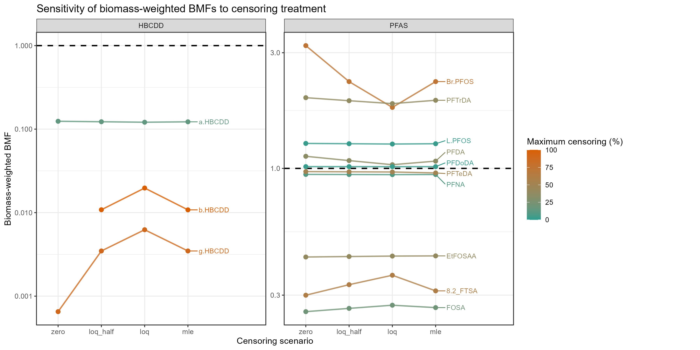

```{r setup, include=FALSE}
knitr::opts_chunk$set(
  echo = FALSE,
  warning = FALSE,
  message = FALSE,
  error = FALSE,
  fig.align = "center",
  fig.width = 7,
  fig.height = 5,
  out.width = "95%"
)

# Cross-document SI references are calculated from the SI chunk inventory.
# These are plain text refreshed on knit, NOT Word REF fields between documents.
source("SI_crossrefs.R", local = TRUE)
```

```{r packages}
library(chopin.BMF)
library(officer)
library(tidyverse)
library(flextable)
```


##### Abstract

Field-based biomagnification factors (BMFs) are often estimated from predator–prey concentration ratios, although these may not represent a physically reconstructed diet or directly measure trophic transfer. We assessed how dietary reconstruction, prey-mass assumptions and left-censored data influence operational BMF estimates for polychlorinated biphenyls (PCBs), hexabromocyclododecane (HBCDD) isomers and per- and polyfluoroalkyl substances (PFASs) in age-0 common sole (*Solea solea*) from the Seine estuary (France).

Contaminant measurements in juvenile sole pools and 16 benthic species were combined with stomach-content observations. We compared prey-specific ratios with diet-based estimates using equal, numerical or biomass weighting; censored observations were treated as zero, half the quantification limit, the quantification limit or by gamma maximum-likelihood imputation, with lognormal fitting as a sensitivity analysis. We also examined literature-derived prey masses, chemical prey coverage and HBCDD censoring bounds.

Annelids contributed 52.4% of prey individuals but 65.4% of estimated biomass; molluscs contributed 15.3% and 1.9%, respectively. Under biomass weighting and gamma-based imputation, median BMFs were 0.719 (PCBs), 0.987 (PFASs) and 0.011 (HBCDDs). Three of 32 compounds crossed BMF = 1 across prey-mass scenarios. The three HBCDD isomers had analytical upper bounds below one despite extensive predator censoring for β- and γ-HBCDD. Removing chemically represented prey species or restricting prey chemistry to seasonal subsets also affected classification for some compounds.

These results demonstrate compound-dependent sensitivity to dietary representation and analytical treatment. Because predator and prey samples were not fully matched and the dietary denominator averaged normalised concentrations rather than measured contaminant masses, the reported BMFs should be interpreted as operational field-based concentration ratios, not direct estimates of contaminant intake or trophic-transfer efficiency.

##### Keywords

Seine estuary; juvenile common sole; nursery habitat; PCBs; HBCDD; PFAS; dietary reconstruction; left-censored data

##### Highlights

- Dietary weighting and prey coverage affect compound-specific BMF estimates.
- HBCDD analytical bounds clarify conclusions under extensive censoring.
- Prey-mass and chemical-coverage scenarios reveal classification sensitivity.

\newpage

# Introduction

Estuarine nurseries support juvenile marine fishes and contribute to recruitment, but they are also exposed to habitat alteration and chemical contamination [@beckIdentificationConservationManagement2001; @lepapeQuantitativeDescriptionHabitat2003; @rochetteEffectNurseryHabitat2010; @halpernGlobalMapHuman2008; @halpernIndexAssessHealth2012]. Contamination may impair juvenile growth, condition and survival [@amaraGrowthConditionIndices2007; @gilliersAreGrowthDensity2006]. Estuaries receive contaminants from watersheds and local sources and can retain persistent substances in sediments, creating potential pathways of exposure for benthic organisms and their predators @ridgwayEstuariesRepositoriesHistorical2002.

Among organohalogenated contaminants, polychlorinated biphenyls (PCBs), hexabromocyclododecane (HBCDD) and per- and polyfluoroalkyl substances (PFASs) display contrasting accumulation processes. The persistence and lipophilicity of PCBs favour tissue accumulation and food-web transfer [@mackayBioaccumulationPersistentOrganic2000; @deribeBioaccumulationPersistentOrganic2011]. HBCDD isomer profiles may differ between commercial mixtures and aquatic organisms, in which α-HBCDD frequently predominates @covaciHexabromocyclododecanesHBCDsEnvironment2006. By contrast, PFAS accumulation involves interactions with proteins and other tissue constituents as well as compound-specific partitioning; trophic enrichment has been reported for several PFASs [@martinDietaryAccumulationPerfluorinated2003; @ahrensFateEffectsPoly2014]. These different properties make joint assessment of the three families informative but complicate direct comparisons.

Biomagnification refers to an increase in contaminant concentration or chemical activity from prey to predator attributable to trophic transfer @gobasBioconcentrationBiomagnificationAquatic2000. Biomagnification factors (BMFs) compare predator and prey concentrations, whereas trophic magnification factors characterise concentration changes across trophic levels @fremlinGuidanceMeasuringEvaluating2025a. Under field conditions, however, a predator-to-prey concentration ratio may be influenced by prey selection, unmeasured exposure pathways and differences in sampling and tissue composition. For predators consuming diverse prey, a diet-based denominator can be reconstructed from the concentrations and relative contributions of potential prey [@mackayBioaccumulationPersistentOrganic2000; @conderUseTrophicMagnification2012]. Such estimates remain operational unless the ingested prey mixture and associated contaminant masses have been measured directly.

Two further uncertainties are particularly relevant to field-based BMFs. Stomach contents describe the number and identity of prey, but not necessarily their contribution to ingested biomass; literature-derived individual masses introduce additional assumptions. Moreover, non-quantified concentrations require an explicit treatment of left-censored observations, which can substantially affect ratios when censoring differs between predators and prey [@borgaTrophicMagnificationFactors2012; @fremlinGuidanceMeasuringEvaluating2025a]. Comparing alternative dietary and censoring assumptions is therefore necessary before interpreting concentration ratios relative to unity.

These uncertainties may interact. The apparent influence of a single prey species depends both on its relative contribution to the reconstructed diet and on whether its contaminant concentrations have been measured or imputed. Similarly, a ratio close to one may change classification following a modest change in dietary weighting even when more extreme ratios remain on the same side of the threshold. A compound-specific sensitivity framework can distinguish these effects without treating classification as evidence of a biological mechanism.

The Seine estuary provides a suitable case study. It is an important nursery for common sole (*Solea solea*) [@riouRelativeContributionsDifferent2001; @rochetteEffectNurseryHabitat2010] and receives historical and contemporary chemical inputs. Legacy PCB and hydrocarbon contamination persists in estuarine sediments @barrois_legacy_2026. PFASs have been documented in the Seine basin [@labadiePartitioningBehaviourPerfluorinated2011; @munozSpatiotemporalDynamicsPolyfluoroalkyl2018], while HBCDDs and PFASs have been reported in shellfish along French coasts @munschyLevelsTrendsEmerging2013. These regional observations provide context but do not establish exposure at individual nursery sampling sites.

We examined age-0 common sole and benthic prey from the Seine estuary to (i) compare prey-specific and diet-based BMF estimates; (ii) assess numerical versus biomass-based dietary weighting; (iii) evaluate alternative treatments of left-censored concentrations; and (iv) quantify compound-specific sensitivity to prey-mass assumptions, chemical prey coverage and analytical censoring. Our emphasis is on the interpretation and robustness of field-based normalised concentration ratios, not on direct measurement of trophic-transfer efficiency.

# Materials and methods

## Study area

The study was conducted in the lower Seine estuary (Eastern English Channel, France), an anthropised system providing nursery habitat for common sole [@riouRelativeContributionsDifferent2001; @rochetteEffectNurseryHabitat2010]. Juvenile soles and benthic macrofauna were sampled in June and October 2017 in three sectors: Fosse Nord, Fosse Sud and Embouchure (Figure \@ref(fig:fig-map)). Samples were pooled across sectors and relevant campaigns because the available replication did not support spatially resolved BMF comparisons. The analysis therefore characterises an integrated estuarine nursery system, rather than matched predator–prey pairs.

The estuary drains a highly populated and industrialised watershed and has accumulated historical sediment-associated contaminants @barrois_legacy_2026. Pooling was an analytical choice motivated by sparse and uneven sampling, not evidence that exposure was spatially or seasonally homogeneous. Differences in local contamination and prey availability remain possible confounders.

```{r fig-map, fig.cap="Location of the study area in the Seine estuary (Eastern English Channel, France), showing the three sampling sectors: Fosse Nord (FN), Fosse Sud (FS), and Embouchure (EM) and corresponding sampling stations.", fig.dim = c(6, 3), fig.show='hold'}
knitr::include_graphics(
  system.file(
    "extdata",
    "map_seine.jpg",
    package = "chopin.data",
    mustWork = TRUE
  )
)
```


## Data sources and biological material

The CHOPIN datasets, sampling protocols, analytical procedures and quality assurance are described in **Mounier et al. (in preparation)** and distributed in `chopin.data` (**version 0.0.1**). We used `soles_contam` (chemical concentrations in age-0 whole-body sole pools), `benthos_contam` (benthic chemistry) and `soles_stomach` (digestive tract contents), complemented by biological, taxonomic and compound metadata.

The analytical inventory comprised ten autumn sole pools and 50 pooled benthic samples from 16 species (nine bivalves, five polychaetes and two crustaceans; `r si_ref("tab-benthos-species", "tab")`). Chemical sample availability differed by compound and family (`r si_ref("tab-censor-audit", "tab")`). Autumn stomach contents came from 124 sole sample identifiers distinct from those analysed chemically. Benthic chemical samples were collected in spring and autumn to improve analytical and taxonomic coverage, whereas sole chemistry and stomach contents were restricted to autumn. Predator and prey chemistry were therefore not necessarily contemporaneous (`r si_ref("tab-sampling-inventory", "tab")`). Benthic species had been selected partly on earlier sole-diet information @riusRepartitionRessourcesAlimentaires2009 and the availability of sufficient material.

Sole pools provided the predator concentration measurements, whereas stomach-content individuals informed dietary weights; these observations do not represent paired measurements on the same fish. Sampling sectors, availability of precise collection dates and analytical family coverage are documented in the sample inventory. Species-level phylum assignments, ecological traits and chemical metadata were retained for reproducibility, but formal comparisons among benthic trait categories were not attempted because of unbalanced sampling.

## Contaminant concentrations and censored data

The analytical dataset comprised 19 PCB congeners, α-, β- and γ-HBCDD, and 29 PFAS compounds. Sample extraction and instrumental methods are documented in **Mounier et al. (in preparation)**. PCB and HBCDD concentrations were normalised to measured total lipids (ng g⁻¹ lipid weight), while PFAS concentrations were expressed on a dry-weight basis (ng g⁻¹ dry weight), given their different partitioning behaviour [@conderUseTrophicMagnification2012; @fremlinGuidanceMeasuringEvaluating2025a]. Protein and polar-lipid measurements required for alternative PFAS normalisation were unavailable.

Chemical protocols used compound- and matrix-specific extraction and purification, including methanol-based extraction for PFASs and organic solvents for PCBs and HBCDDs. Concentrations were compared only within a common compound and normalisation basis; estimates from different chemical families were not interpreted as directly comparable measures of tissue partitioning.

Observations below compound-specific limits of quantification (LOQs) were treated as left-censored. Compounds with at least 80% censored measurements in either sole pools or the pooled benthic dataset were excluded from the main PCB and PFAS comparisons. All three HBCDD isomers were retained for a separate exploratory analysis despite extensive censoring, motivated by previous evidence of isomer-dependent accumulation and transformation in other fish species [@lawHBCDBioisomerization2006; @duHBCDBioisomerization2012].

We compared four censoring treatments: substituting zero, LOQ/2 or LOQ, and maximum-likelihood-based imputation (MLE) @borgaTrophicMagnificationFactors2012. Quantified values were never altered. The reference MLE used a gamma distribution fitted separately for each compound and biological group (sole pools or a benthic prey species), with lognormal MLE as a sensitivity analysis. The gamma family was a pragmatic model for positive skewed data, not an assumption verified for every compound [@gilliom_estimation_1986; @shoari_estimating_2015]. A fit required at least three observations, including two quantified positive values; each censored observation was assigned the fitted conditional mean below its own LOQ. Otherwise, LOQ/2 was used as a documented fallback. Model diagnostics, fallback reasons and the group-level imputation audit are supplied in Supplementary Dataset S1.

## Dietary composition and prey biomass estimation

Autumn diet was reconstructed from pooled stomach and intestinal contents of age-0 soles. Fish remains and taxa occurring in fewer than three soles were excluded. Numerical proportions represented prey-individual counts; biomass proportions used the estimated individual ash-free dry weight (AFDW) of each taxon.

Individual AFDW estimates (mg ind⁻¹) were derived from Btrait [@soetaertBtrait2023; @beauchard_assessing_2023] and the Gogina et al. dataset @gogina_weight_weight_2022. When both sources described a species, the lower median mass was selected as a proxy for relatively small prey. Otherwise, taxa were matched at the most specific shared taxonomic rank, and the median of reference-species medians was used where necessary (matching details in the Supplementary). These literature-derived values are proxies, not measured masses of ingested prey. For bivalves, a fixed factor of 0.0375 represented the potentially consumed siphon tissue, informed by estimates of siphon contributions in *Scrobicularia plana* and *Limecola balthica* @zwarts_feeding_1994.

Reference individuals originated in part from the Baltic and North seas, so size distributions may differ from those of prey available to age-0 sole in the Seine estuary. The lower-median rule was intended to avoid assigning unusually large reference animals to juvenile-sole prey, but can introduce a directional bias. Similarly, a common siphon factor is a practical approximation rather than a species-specific measurement; its influence was evaluated separately.

For prey phylum $p$, dietary proportions were calculated as

$$
P_{N,p}=\frac{\sum_{s\in S_p}N_{p,s}}{\sum_q\sum_{s\in S_q}N_{q,s}},
\qquad
P_{B,p}=\frac{\sum_{s\in S_p}N_{p,s}M_{p,s}}{\sum_q\sum_{s\in S_q}N_{q,s}M_{q,s}},
$$

where $S_p$ is the set of prey taxa assigned to phylum $p$, $N_{p,s}$ is the observed number of prey individuals, and $M_{p,s}$ is their estimated individual AFDW. Biomass proportions were calculated for taxa with valid mass estimates. The three main chemically represented phyla were Annelida, Arthropoda and Mollusca.

Numerical percentages used all eligible recorded prey counts, whereas biomass percentages were renormalised over the taxa with available masses. The dietary weighting schemes were then aggregated at phylum resolution to match the resolution of the chemically reconstructed dietary denominator. Taxa present in digestive tracts but not identified in the chemical dataset therefore remained part of the ecological diet description without being assigned an unsupported species-specific contaminant concentration.

To examine the influence of reference prey masses, all taxon masses were simultaneously replaced by their Q25, median or Q75 estimates using a constant set of taxa. These scenarios explore deterministic sensitivity, not probability intervals or measured variation among ingested prey.

## Biomagnification factor estimation

We calculated prey-specific and reconstructed diet-based field BMF estimates for each compound @schaferBioaccumulationAquaticSystems2015. Because predator and prey were not individually matched, these are operational normalised concentration ratios. A value above one indicates a higher normalised concentration in soles than in the selected reference, without independently demonstrating trophic biomagnification.

### Predator–prey BMFs

For prey species $s$ and compound $c$,

$$
\mathrm{BMF}_{s,c}=\frac{\overline C_{\mathrm{sole},c}}{\overline C_{s,c}},
$$

where each term is the arithmetic mean concentration within the relevant biological group. For each censoring scenario, prey-specific ratios were summarised by their median, interquartile range and extrema across chemically analysed species.

### Diet-based BMFs

Within a chemical scenario, concentrations were averaged first within each benthic species, then equally across analysed species belonging to each phylum. The diet-based denominator for compound $c$ was

$$
C_{\mathrm{diet},c}=\sum_{p}w_p\overline C_{p,c},\qquad
\mathrm{BMF}_{\mathrm{diet},c}=\frac{\overline C_{\mathrm{sole},c}}{C_{\mathrm{diet},c}},
$$

where $w_p$ denotes equal, numerical or biomass-based phylum weights (normalised across the chemically represented phyla), and $\overline C_{p,c}$ is the mean of available species-level concentrations within phylum $p$. The denominator is a weighted average of normalised concentrations, **not a physically reconstructed mixture of ingested prey tissues**, because the weights are not derived from measured lipid or dry-matter masses of consumed prey. We therefore interpret the estimates as operational concentration ratios rather than ingested contaminant doses or transfer efficiencies.

### Comparison of methods and sensitivity analyses

Four censoring treatments crossed with three dietary weighting approaches yielded 12 scenarios per retained compound. The effect of replacing numerical with biomass weighting was expressed as

$$
\Delta_{\mathrm{weight},c}(\%)=100\left(\frac{\mathrm{BMF}_{\mathrm{biomass},c}}{\mathrm{BMF}_{\mathrm{numeric},c}}-1\right).
$$

Diet-based ratios were also compared with the median of the prey-specific ratios calculated for the same compound and censoring scenario; classification changes relative to BMF = 1 were recorded. We assessed the correspondence between stomach-content taxa and taxa chemically analysed (Supplementary Methods).

Additional deterministic diagnostics varied the bivalve siphon correction between 0.02 and 0.05, and replaced median taxon masses with Q25 or Q75 values. For compound $c$, the mass-related sensitivity range was the minimum and maximum among the three resulting ratios, not necessarily the values obtained with Q25 and Q75 masses:

$$
\mathrm{BMF}^{(k)}_c=\frac{\overline C_{\mathrm{sole},c}}{C^{(k)}_{\mathrm{diet},c}},\quad
\mathrm{BMF}_{c,\min}=\min_{k}\mathrm{BMF}^{(k)}_c,\quad
\mathrm{BMF}_{c,\max}=\max_{k}\mathrm{BMF}^{(k)}_c,
\quad k\in\{Q25,\mathrm{median},Q75\}.
$$

The ratio of the maximum to minimum positive BMF was calculated when defined. All mass diagnostics used reference gamma-MLE concentrations and fixed taxonomic composition. They do not incorporate covariance between taxon-specific masses.

Relative changes from the median prey-specific BMF were also recorded for each dietary weighting method and compound, using the same censoring scenario. These comparisons describe how the choice of an integrated dietary denominator shifts the ratio relative to the central tendency of chemically analysed prey; they do not establish which reference is closer to a true ingested mixture.

In a leave-one-chemically-analysed-prey-species-out diagnostic, each chemically analysed species was removed in turn. Mean phylum concentrations and reference biomass-weighted BMFs were recomputed while dietary biomass weights remained fixed. Where removal eliminated the only chemically represented species in a phylum, that phylum was excluded and remaining weights were renormalised. We recorded magnitude and classification changes; this tests sensitivity to chemical taxonomic coverage, not uncertainty in the observed diet.

An exploratory comparison recalculated reference BMFs using spring-only or autumn-only benthic chemical observations, holding sole concentrations, dietary weights and full-dataset gamma-MLE imputations constant. Because sample composition and taxonomic coverage differed between subsets, the comparison does not isolate a causal seasonal effect. Descriptive summaries and other sensitivity results are reported in the Supplementary (`r si_ref("tab-prey-season", "tab")`).

### HBCDD analysis under extensive censoring

For α-, β- and γ-HBCDD, quantification frequencies were reported separately for sole and prey. In addition to the four main treatments, analytical bounds were obtained by assigning censored measurements either zero or their individual LOQ while retaining quantified values. With fixed dietary reconstruction, the most conservative BMF bounds were

$$
\mathrm{BMF}_{\min}=\frac{C_{\mathrm{sole},\min}}{C_{\mathrm{diet},\max}},\qquad
\mathrm{BMF}_{\max}=\frac{C_{\mathrm{sole},\max}}{C_{\mathrm{diet},\min}}.
$$

An upper bound was unbounded where the lower dietary denominator equalled zero. These are analytical censoring bounds, not confidence intervals; they do not include uncertainty in prey identification, masses or exposure.

### Hierarchical methodological sensitivity

Dietary and censoring sensitivity were compared within each compound using the median log₂ fold range of BMF estimates across dietary weights at fixed censoring treatment, or across censoring treatments at fixed dietary weighting, respectively. The logarithmic analysis required 12 strictly positive finite estimates per compound; eligibility and exclusion reasons were recorded.

A complementary zero-compatible sensitivity metric retained compounds with complete, finite, non-negative BMFs:

$$
D=\frac{\mathrm{BMF}_{\max}-\mathrm{BMF}_{\min}}{\mathrm{BMF}_{\max}+\mathrm{BMF}_{\min}}.
$$

It ranges from zero (no difference) to one (minimum zero and maximum positive); if both extrema were zero, $D$ was defined as zero. $D_{\mathrm{diet}}$ and $D_{\mathrm{censor}}$ were calculated across the corresponding scenario contrasts and summarised by their medians for each compound. Both sensitivity indices are descriptive, not inferential. Analyses were performed in R @Rcoreteam; given uneven replication and compound dependence, we prioritised effect sizes over formal hypothesis testing.

The scenario inventory, group-level censoring decisions, eligibility for the logarithmic hierarchy and the distinction between prey-mass bounds and analytical censoring bounds were recorded separately. This separation prevents variation induced by assumed prey masses from being mistaken for uncertainty caused by non-quantified concentrations.

# Results

## Dietary composition and biomass weighting

Annelids dominated the reconstructed age-0 sole diet: 52.4% of prey individuals and 65.4% of estimated biomass (Fig. \@ref(fig:fig-prey-contributions)). Arthropods contributed 32.1% numerically and 32.6% by biomass, whereas molluscs decreased from 15.3% numerically to 1.9% by biomass. Cnidarians represented less than 0.3%. Biomass weighting particularly increased the contributions of *Nephtys* spp., Nereididae, *Lanice conchilega* and *Hediste diversicolor*, while decreasing that of numerically abundant *Polydora ciliata*.

Taxonomic correspondence with the chemically analysed benthos was incomplete (`r si_ref("tab-diet-matching", "tab")`). Identically designated taxa represented 62.3% of estimated dietary biomass (36.3 percentage points from annelids and 26.0 from arthropods). In annelids, 29.0% of total dietary biomass was associated with categories lacking an identical designation in the chemical dataset. This incomplete correspondence motivated the phylum-level chemical reconstruction and the leave-one-out diagnostic.

Although the chemical data included nine bivalves, five polychaetes and two crustaceans, these taxa did not constitute a complete inventory of organisms observed in the digestive tracts. A direct name match could be absent when digested prey could be assigned only to a higher taxonomic rank. The matching metric is therefore a measure of correspondence between recorded designations and available measurements, not an estimate of the proportion of prey for which contamination was necessarily unknown.

```{r fig-prey-contributions, fig.cap="Changes in the estimated dietary contributions of prey taxa, identified to the lowest practicable taxonomic level,  when numerical proportions are replaced by biomass-weighted proportions in the diet of age-0 common sole (Solea solea) from the Seine estuary. Bars represent the difference in percentage points between biomass-weighted and numerical contributions (biomass minus numerical proportion). Positive values indicate a greater contribution to estimated dietary biomass than to prey abundance, whereas negative values indicate the opposite. Biomass proportions were calculated using literature-derived estimates of individual prey ash-free dry weight (AFDW), with a correction factor of 3.75% applied to bivalves to approximate the potentially ingested siphonal tissues.", fig.show='hold'}
knitr::include_graphics(
  "../manuscript/figures/Fig.2_prey_contributions_compare.jpg"
  )
```


## Predator–prey and diet-based BMF estimates

Prey-specific concentration ratios varied markedly across benthic species, sometimes by more than an order of magnitude for a compound (Fig. \@ref(fig:fig-bmfs-diet)). Diet-based estimates usually fell within the observed prey-specific range, but their position depended on the chemical and dietary weighting scheme. PCB ratios were comparatively stable across the three dietary weights, whereas PFAS responses were compound-specific and HBCDD ratios differed more strongly across weighting methods (`r si_ref("fig-diet-weighting-delta", "fig")`). Changing the bivalve siphon factor from 0.02 to 0.05 did not cause any ratio to cross unity (`r si_ref("fig-siphon-bmf", "fig")`).

Under equal weighting, all chemically represented phyla contributed identically to the denominator irrespective of their observed dietary abundance. Numerical and biomass weighting instead reflected distinct ecological assumptions about prey contributions. The extent and direction of the resulting BMF changes consequently depended on whether the more heavily weighted phyla had relatively high or low normalised concentrations for the compound considered. The generally limited PCB sensitivity contrasted with the larger variation among HBCDD reconstructions.

Under reference biomass weighting and gamma-MLE censoring treatment, median BMFs were 0.719 for PCBs (range 0.104–1.017; 1/19 above unity), 0.987 for PFASs (0.267–2.281; 5/10 above unity), and 0.011 for HBCDD isomers (0.003–0.122; none above unity). These values are normalised concentration ratios, not measured trophic transfer efficiencies.

Most reference PCB and all HBCDD ratios therefore remained below unity, while five of ten retained PFAS ratios exceeded it. Importantly, this threshold classification describes the position of a particular reconstructed ratio; the analysis was not designed to test whether dietary uptake caused the observed predator concentrations. The distributions of individual prey ratios further show that a change in the chemical reference alone can shift a compound's apparent position.

```{r fig-bmfs-diet, fig.cap="Comparison of field-based normalised predator–prey and predator-to-diet concentration ratios (operational BMF estimates) for individual PCB congeners, HBCDD isomers and PFAS compounds in age-0 common sole from the Seine estuary. Grey points represent ratios calculated between juvenile soles and individual benthic prey species. Black diamonds indicate the median predator–prey ratio, and horizontal black segments represent the interquartile range (Q25–Q75) across prey species. Coloured points represent predator-to-diet ratios calculated using equal, numerical or biomass-based dietary weighting. All estimates were obtained using gamma-based maximum-likelihood imputation for left-censored concentrations, with LOQ/2 fallback where fitting was not feasible. The dashed vertical line indicates a concentration ratio of one. These ratios compare normalised concentrations and do not represent measured contaminant intake or trophic transfer efficiency.", fig.show='hold'}
knitr::include_graphics(
  "../manuscript/figures/Fig.3_predator_prey_vs_diet.png"
  )
```


## Sensitivity to analytical censoring

The chemical inventory comprised 19 PCB congeners, three HBCDD isomers and 29 PFAS compounds; 19 PFASs failed the 80% censoring criterion, leaving 19 PCBs, three HBCDDs and ten PFASs for the BMF comparisons. No PCB observations were censored. The three HBCDD isomers were retained despite the high proportion of non-quantified predator measurements (Fig. \@ref(fig:fig-bmfs-censor)).

α-HBCDD was quantified in all ten sole pools and 25/29 prey samples (86.2%). β-HBCDD was quantified in no sole pools but in 20/29 prey samples (69.0%), while γ-HBCDD was quantified in 1/10 sole pools (10%) and 22/26 prey samples (84.6%). Because model-fitting requirements were not met for β- and γ-HBCDD in sole, the MLE scenario used LOQ/2 fallback. Reference biomass-weighted BMFs were 0.1223, 0.0108 and 0.0035 for α-, β- and γ-HBCDD, respectively. Their analytical bounds were 0.1210–0.1242, 0–0.0240 and 0.0006–0.0064; all upper bounds remained below unity (`r si_ref("tab-hbcdd-bounds", "tab")`; `r si_ref("fig-hbcdd-bounds", "fig")`; `r si_ref("fig-hbcdd-bounds-zoom", "fig")`).

The gamma audit covered 480 compound-by-biological-group combinations, of which 79 contained censored measurements. Gamma-MLE fits were obtained for 36 such groups; 43 used LOQ/2 fallback (21 with fewer than three observations and 22 with fewer than two quantified values). Gamma and lognormal estimates were similar (maximum absolute relative BMF difference 4.35%, with no classification changes); their agreement therefore partly reflects fallback use, not demonstrated distributional adequacy. β-HBCDD yielded BMF = 0 under zero substitution and could not be displayed on a logarithmic axis.

These differences in quantification frequency mattered more for β- and γ-HBCDD than the nominal choice between gamma and lognormal fitted distributions, because there were too few quantified sole values to estimate their predator concentration distributions by MLE. Their point estimates are consequently conditional on the substitution fallback, whereas the analytical bounds transparently bracket the possible contribution of censored measured concentrations under the fixed diet scenario.

```{r fig-bmfs-censor, fig.cap="Sensitivity of biomass-weighted biomagnification factor (BMF) estimates to four methods for treating left-censored contaminant concentrations in age-0 common sole and benthic prey from the Seine estuary. BMF estimates for individual HBCDD isomers and PFAS compounds are shown under four analytical scenarios: substitution by zero, half the limit of quantification (LOQ/2), the LOQ, and gamma-based maximum-likelihood imputation (MLE), with LOQ/2 fallback when fitting was not feasible. Lines connect estimates for the same compound across scenarios. Line and point colours indicate the maximum percentage of censored observations recorded in either predator or prey samples. The dashed horizontal line indicates BMF = 1. The y-axis is logarithmic. PCB congeners are not represented because no PCB concentrations were censored. BMF estimates represent field-based ratios of normalised predator and reconstructed dietary concentrations, rather than directly measured trophic transfer efficiencies. Values above unity indicate higher normalised concentrations in juvenile soles than in the reconstructed dietary denominator under the specified methodological scenario.", fig.show='hold'}

```


## Relative importance of methodological choices

The logarithmic sensitivity hierarchy included 19 PCBs, ten PFASs and two HBCDD isomers (Fig. \@ref(fig:fig-sensitivity)). β-HBCDD was ineligible because zero substitution yielded BMF = 0, but was retained in the isomer-specific analysis and the zero-compatible $D$ analysis (`r si_ref("fig-zero-safe-sensitivity", "fig")`; `r si_ref("tab-sensitivity-eligibility", "tab")`). HBCDDs showed the greatest median dietary sensitivity (7.81-fold) and a 3.13-fold median censoring sensitivity; the corresponding PCB medians were 1.07- and 1.00-fold. Dietary weighting was the dominant factor for eight of ten PFASs, censoring for two. The hierarchy pertains only to eligible compounds.

Because the PCB censoring contrast was identically absent in this dataset, the relative ranking of diet and censoring sensitivity for PCBs should not be extrapolated to studies with higher analytical limits. Similarly, the large HBCDD diet fold range includes comparisons involving equal phylum weights and should not be attributed solely to replacing numerical prey counts with biomass weights. The bounded $D$ index complements rather than rescales these logarithmic fold ranges.

With Q25, median and Q75 prey masses, three of 32 compounds changed classification relative to unity (CB118, PFNA and PFTeDA); the largest fold range was 5.55 for γ-HBCDD. Median family fold ranges were 1.19 (PCBs), 4.81 (HBCDDs) and 1.55 (PFASs) (`r si_ref("tab-bmf-mass", "tab")`; `r si_ref("fig-bmf-mass-ranges", "fig")`; `r si_ref("fig-bmf-mass-crossings", "fig")`). The extrema were not necessarily associated with the Q25 and Q75 scenarios, respectively.

For a given phylum, changing every taxon's assumed mass can alter its share of the total reconstructed biomass in a non-monotone way, especially when several taxa contribute different amounts. The mass-scenario results therefore demonstrate an effect of the relative allocation of dietary weights, rather than a simple positive or negative relationship between prey size and BMF.

The leave-one-chemically-analysed-prey-species-out diagnostic comprised 448 compound-by-species removals for 32 compounds. Twenty-five removals changed classification, affecting 18 distinct compounds (14 PCBs and four PFASs, but no HBCDDs). Removing *Corophium volutator* accounted for 13 changes, *Hediste diversicolor* for four and *Owenia fusiformis* for three. Removing *Crangon crangon* eliminated the only chemically characterised arthropod for three HBCDD ratios (`r si_ref("tab-loo-family", "tab")`; `r si_ref("fig-loo-species", "fig")`; `r si_ref("fig-loo-compounds", "fig")`).

In the exploratory prey-chemistry subset comparison, autumn-only data changed classification for 1/19 PCBs and 2/10 PFASs relative to the pooled-season reference; spring-only data changed classification for 16/19 PCBs and 2/10 PFASs. No HBCDD changed classification, but the spring HBCDD subset represented only two phyla and 67.2% of reference dietary biomass weights, compared with three phyla and 99.8% in autumn (`r si_ref("tab-prey-season", "tab")`). These comparisons confound sampling season, species availability and chemical coverage.

For HBCDD, no classification changes were detected despite substantially poorer spring chemical coverage. This difference illustrates that a stable threshold classification can coexist with a poorly constrained chemical denominator. The comparisons should accordingly be treated as a coverage diagnostic alongside the leave-one-out test, rather than as estimates of the biological effect of spring versus autumn exposure.

```{r fig-sensitivity, fig.cap="Relative sensitivity of diet-based biomagnification factor (BMF) estimates to dietary weighting and censored-data treatment for HBCDD isomers and PFAS compounds (no PCB measurements were censored). Dietary sensitivity was calculated as the median log₂-transformed ratio between the maximum and minimum BMF estimates across three dietary weighting approaches (equal, numerical, and biomass), considering each censoring treatment separately. Censoring sensitivity was calculated using the corresponding range across four treatments (zero, LOQ/2, LOQ, and gamma-based MLE), considering each dietary weighting approach separately. Points represent individual compounds, and colours indicate the maximum percentage of censored observations in predator or prey samples. The dashed line indicates equal sensitivity to both methodological factors. Compounds below the line are more sensitive to dietary weighting, whereas compounds above the line are more sensitive to censored-data treatment. PCB congeners are excluded because no PCB concentrations were censored.", fig.show='hold'}
knitr::include_graphics(
  "../manuscript/figures/Fig.5_methodological_sensitivity_hierarchy.png"
  )
```


# Discussion

## Diet reconstruction and representation of prey

The central result is that field-based BMF estimates depend on the choice and representation of prey. Individual benthic species yielded widely different predator–prey concentration ratios, consistent with differences in exposure, ecology and physiology @schaferBioaccumulationAquaticSystems2015. Benthic suspension and deposit feeders may encounter different contaminant pathways, but these categories do not establish uptake mechanisms. The elevated PCB concentrations recorded for *Limecola balthica* relative to some other deposit-feeding bivalves (`r si_ref("fig-contamination-levels", "fig")`) might reflect species-specific processes, spatial variability or sampling differences. Previous studies describe substantial estuarine heterogeneity in persistent pollutants [@olisahStatePersistentOrganic2021; @vanaelPersistentOrganicPollutants2012], while habitat differences can confound species comparisons @pitaccoHabitatHeterogeneityConfounding2021. Neither a taxonomic nor a feeding-mode effect could be isolated in our unevenly sampled dataset.

This makes the selection of a reference prey particularly consequential. A single benthic taxon is rarely a complete proxy for the diet of a generalist juvenile fish, even if that taxon is common or easily sampled. Conversely, averaging available prey concentrations can introduce its own bias when chemical coverage overrepresents particular species or feeding habitats. The broad dispersion of prey-specific ratios in our results is therefore best understood as both a biological signal and a warning about reference selection.

Diet reconstruction explicitly incorporates prey composition but introduces assumptions about the meaning of dietary weights. Numerical counts overrepresent small abundant prey relative to their biomass contributions; the shift from molluscs to annelids in this study shows why weighting matters. Nevertheless, biomass estimates came from reference datasets rather than the ingested prey, and a universal bivalve siphon correction approximated tissue actually consumed. Although varying that correction had a limited effect, changing individual taxon masses across their literature quartiles altered BMF classification for three compounds. Because all masses were varied simultaneously, Q25–median–Q75 ranges describe deterministic methodological sensitivity rather than confidence or credible intervals, and do not represent covariance or probabilities of prey-mass combinations.

Greater dietary realism is useful only when contaminant measurements represent the prey consumed. Identically designated stomach and chemical taxa accounted for 62.3% of dietary biomass, and phylum averages give equal weight to sampled chemical species, regardless of how frequently they were actually eaten. The leave-one-out analysis therefore identifies leverage arising from the **chemical representation** of taxa, not uncertainty in stomach-content identification or feeding behaviour. The particularly strong influence of *Corophium volutator* illustrates this point. Directly matching dietary and chemically analysed prey would reduce this source of sensitivity.

The leave-one-out design deliberately held dietary biomass proportions fixed; it did not re-estimate stomach contents or impute alternative taxonomic identities. It should thus not be interpreted as measuring uncertainty in actual feeding behaviour. A future design that combines individual-level diet data with contamination measurements on the same prey taxa would permit these two dimensions of uncertainty—diet composition and chemical coverage—to be assessed separately. Ecologically informed diet reconstruction remains preferable to selecting an arbitrary single reference prey, but is not intrinsically an unbiased measure of contaminant intake [@gobasMechanismBiomagnificationFish1999; @mounierDietaryBioaccumulationPersistent2020]. Digestibility, bioaccessibility and food composition also influence assimilation @liuInfluenceDietAssimilation2010.

This distinction is especially relevant when contrasting numerical and biomass weighting. More realistic prey mass estimates can improve the representation of how much biological material might be consumed, but they do not identify which tissue fractions enter the gut or how efficiently compounds are absorbed. For lipophilic contaminants, feeding-related accumulation can be influenced by diet composition and physiological processing in addition to nominal contaminant concentrations [@gobasMechanismBiomagnificationFish1999; @mounierDietaryBioaccumulationPersistent2020].

## Compound-specific patterns and analytical censoring

PCBs, PFASs and HBCDDs differed in both their ratios and methodological sensitivity. PCB estimates were comparatively stable across dietary weights and unaffected by alternative censoring treatments because none of their measurements were censored. This does not imply that PCB trophic transfer is universally insensitive to methodology: congener properties, assimilation and biotransformation also influence accumulation @gewurtzComparisonContaminantDynamics2006. PFASs showed greater compound-specific variation, consistent with the heterogeneous accumulation reported across aquatic systems [@houdeBiologicalMonitoringPolyfluoroalkyl2006; @conderArePFCAsBioaccumulative2008; @ngBioaccumulationFlUorinated2014; @munozEvidenceTrophicTransfer2017]. A recent meta-analysis likewise documents variable PFAS trophic magnification, although TMFs and our operational BMFs are not interchangeable @ricolfi_unravelling_2025.

The PFAS compounds retained after censoring screening do not represent all 29 analysed PFASs. Consequently, the observed distribution of ratios and the eight-versus-two dominance of dietary versus censoring sensitivity relate only to the ten compounds with sufficient quantification coverage. This selection makes cautious comparison with broader PFAS surveys especially important. Published assessments of perfluoroalkyl accumulation also differ in the organisms, exposure histories and dietary references included [@houdeBiologicalMonitoringPolyfluoroalkyl2006; @conderArePFCAsBioaccumulative2008].

Concentration normalisation also limits comparisons among families and studies. PCB and HBCDD concentrations were lipid-normalised, whereas PFAS concentrations were expressed per unit dry mass. Many PFASs associate with proteins and membrane phospholipids, making total-lipid normalisation inappropriate for some compounds [@kellyPerfluoroalkylContaminantsArctic2009; @conderUseTrophicMagnification2012; @fremlinGuidanceMeasuringEvaluating2025a]. More specific biochemical normalisers could be useful but were unavailable. Likewise, the agreement of gamma and lognormal MLE should be interpreted cautiously: many censored groups could not be fitted and instead received identical LOQ/2 fallback values. Compound-specific censoring distributions, not just overall censoring percentages, determine the effect on ratios.

For example, censoring concentrated in the predator can shift the numerator across substitution treatments, whereas censoring concentrated in particular prey taxa affects a weighted dietary denominator. Fallback imputation must therefore remain visible in the reporting even when the overall gamma-versus-lognormal comparison suggests modest differences. The complete censoring audit is essential to interpreting which values were determined by the data and which were substituted under a stated rule.

HBCDDs require a distinct interpretation. α-HBCDD was quantified in all ten sole pools, but β-HBCDD was never quantified and γ-HBCDD was quantified in only one, despite frequent quantification of both isomers in benthic prey. Experimental bioisomerisation of β- and γ-HBCDD to α-HBCDD has been reported in rainbow trout and zebrafish [@lawHBCDBioisomerization2006; @duHBCDBioisomerization2012], and isomer-specific trophic patterns have been documented elsewhere @ruanStereoisomerSpecificTrophodynamicsChiral2018. However, **the field observations do not demonstrate bioisomerisation in *Solea solea***. Differential exposure, uptake and elimination remain alternative explanations. For the reference dietary weights, the analytical upper BMF bounds were below unity for all three isomers, even with extensive predator censoring. These bounds are conditional on the sampled concentrations and fixed dietary reconstruction; they are not statistical confidence limits or mechanistic tests. Targeted uptake, elimination and transformation experiments would be necessary to identify the processes responsible.

The two sensitivity hierarchies answered related but different questions. Logarithmic fold ranges quantify relative differences for strictly positive estimates, whereas the bounded $D$ metric accommodates zero-valued BMFs without an arbitrary offset, notably β-HBCDD. Neither establishes statistical uncertainty; classification changes relative to unity provide an additional, easily interpreted diagnostic for ratios close to that threshold.

The classification metric is itself sensitive to proximity to one: small methodological differences may matter for a borderline compound but not for a compound whose ratio lies far below unity. Reported fold ranges and threshold crossings should therefore be interpreted together. Neither substitutes for uncertainty estimates based on replicated sampling, and the scenario calculations should not be described as independent tests of a contaminant's inherent biomagnification potential.

## Interpretation, limitations and priorities for future studies

A major limitation is incomplete matching of predator, diet and prey chemical observations. Sole pools and stomach contents represent autumn, whereas prey chemistry pools observations from spring and autumn across the nursery. The exploratory season-restricted comparison showed substantial PCB sensitivity, especially in the spring-only subset, but **cannot be interpreted as a causal seasonal signal**: the species, sample numbers and taxonomic coverage differ. Unchanged HBCDD classification in spring is particularly weak evidence of stability when the chemically represented phyla account for only 67.2% of the dietary weights. Better spatially and temporally matched sampling is a priority.

A useful future sampling design would include predator and prey chemistry collected within comparable time windows and sectors, with replicated specimens of the dominant chemically relevant prey taxa. This would allow temporal and taxonomic changes to be examined separately and reduce the need to pool across campaigns. The present pooled design was necessary to achieve adequate chemical representation but should not be treated as providing a time-integrated dose for each sole.

A second limitation concerns the physical meaning of the dietary denominator. We averaged **normalised prey concentrations** using numerical or AFDW-based diet weights, rather than calculating the contaminant mass in a measured prey mixture relative to that mixture's lipid or dry mass. Physical reconstruction would require prey-taxon contaminant masses and compatible tissue-composition measurements. Lipid contents were available for 13 of 16 chemically analysed benthic species (1.12–3.69% of dry weight), but not all prey taxa; literature AFDW is also not directly interchangeable with measured dry tissue mass. Consequently, the reported ratios permit comparisons among methodological assumptions but should not be interpreted as consumed doses, trophic-transfer efficiencies or direct proof of biomagnification when they exceed one.

This distinction does not make the ratios uninformative: when concentration measurements and normalisation rules are applied consistently, they provide a useful common scale for comparing analytical treatments, dietary reconstructions and contaminants. It does, however, limit their use for mechanistic inference. A future physical-mixture approach would need compatible prey-tissue mass fractions and, ideally, the composition of tissue actually eaten rather than a single phylum-wide normalisation assumption.

These uncertainties reinforce recommendations for representative prey sampling, explicit normalisation and careful interpretation of field-based trophic concentration ratios [@borgaTrophicMagnificationFactors2012; @conderUseTrophicMagnification2012; @kimEvaluatingRolesBiotransformation2016; @arnot_weight_2023; @fremlinGuidanceMeasuringEvaluating2025a]. Future studies should jointly characterise stomach contents, prey masses, tissue composition and chemical concentrations across comparable times and sites, with sufficient analytical sensitivity to reduce left-censoring. Such designs would better separate biological processes from the effects of dietary reconstruction and incomplete chemical coverage.

They would also allow the sensitivity framework developed here to be tested on more representative predator–prey samples, potentially linking operational ratios to mechanistic bioaccumulation models without treating the current scenarios as formal confidence limits.

# Conclusion

Field-based BMF estimates for juvenile sole in the Seine estuary were sensitive to how prey were represented, how censored concentrations were treated and which individual prey masses were assumed. These effects differed among compounds: three of 32 ratios crossed unity under alternative prey-mass scenarios, while leaving out chemically analysed prey species or restricting seasonal chemical coverage generated additional classification changes. HBCDD analytical bounds remained below unity under fixed reference dietary weights despite extensive censoring; contrasting isomer profiles do not demonstrate bioisomerisation in common sole.

These findings support combining dietary observations, transparent censoring treatment and compound-specific sensitivity analyses. More closely matched predator–prey sampling, better taxonomic chemical coverage and measured prey tissue composition would improve interpretation. Until then, the estimates are most appropriately regarded as operational normalised concentration ratios, not direct measurements of contaminant intake or trophic-transfer efficiency.

The principal value of this approach is to identify which assumptions change the scientific interpretation of a compound and which conclusions remain stable across explicitly documented scenarios.


##### References

::: {#refs}
:::
