```{r setup, include=FALSE}
knitr::opts_chunk$set(
  echo = FALSE,
  warning = FALSE,
  message = FALSE,
  error = FALSE,  
  ft.keepnext = FALSE,
  fig.align = "center",
  fig.width = 7,
  fig.height = 5,
  out.width = "95%"
)
```

```{r packages}
library(chopin.data)
library(chopin.BMF)
library(officer)
library(tidyverse)
library(flextable)
```

##### Supplementary materials

## Chemical names and CAS


```{r tbl-chemical-inventory, tab.id="tab-chemical-inventory", tab.cap="List of per- and polyfluoroalkyl substances (PFAS), hexabromocyclododecane (HBCDD) isomers and polychlorinated biphenyl (PCB) congeners included in the chemical inventory, with their chemical subgroups, acronyms, common names and Chemical Abstracts Service (CAS) registry numbers. An asterisk (*) identifies compounds excluded from the field-based biomagnification factor (BMF) analyses according to the current selection decisions. Exclusion and assessment statuses were generated from the current analytical pipeline rather than assigned manually.", echo=FALSE, message=FALSE, warning=FALSE}

# 1. Chemical inventory: descriptive information only.
# Exclusion decisions are NOT coded in this table.

contaminants_info <- tribble(
  ~Family, ~Group, ~Acronym, ~Common_name, ~CAS,

  "PFAS", "PFCA", "PFPeA", "Perfluoropentanoic acid", "2706-90-3",
  "PFAS", "PFCA", "PFHxA", "Perfluorohexanoic acid", "307-24-4",
  "PFAS", "PFCA", "PFHpA", "Perfluoroheptanoic acid", "375-85-9",
  "PFAS", "PFCA", "PFOA", "Perfluorooctanoic acid", "335-67-1",
  "PFAS", "PFCA", "PFNA", "Perfluorononanoic acid", "375-95-1",
  "PFAS", "PFCA", "PFDA", "Perfluorodecanoic acid", "335-76-2",
  "PFAS", "PFCA", "PFUnDA", "Perfluoroundecanoic acid", "2058-94-8",
  "PFAS", "PFCA", "PFDoDA", "Perfluorododecanoic acid", "307-55-1",
  "PFAS", "PFCA", "PFTrDA", "Perfluorotridecanoic acid", "72629-94-8",
  "PFAS", "PFCA", "PFTeDA", "Perfluorotetradecanoic acid", "376-06-7",

  "PFAS", "PFSA", "PFBS", "Perfluorobutanesulfonic acid", "375-73-5",
  "PFAS", "PFSA", "PFHxS", "Perfluorohexanesulfonic acid", "355-46-4",
  "PFAS", "PFSA", "PFHpS", "Perfluoroheptanesulfonic acid", "375-92-8",
  "PFAS", "PFSA", "L-PFOS", "Perfluorooctanesulfonic acid", "4021-47-0 (L-)",
  "PFAS", "PFSA", "Br-PFOS", "Perfluorooctanesulfonic acid", "4021-47-0 (Br-)",
  "PFAS", "PFSA", "PFDS", "Perfluorodecanesulfonic acid", "355-77-3",

  "PFAS", "FOSA", "FOSA", "Perfluorooctanesulfonamide", "754-91-6",
  "PFAS", "N-Alkyl FOSAA", "FOSAA",
  "Perfluorooctanesulfonamidoacetic acid", "2806-24-8",
  "PFAS", "N-Alkyl FOSAA", "MeFOSAA",
  "N-Methylperfluorooctanesulfonamidoacetic acid", "2355-31-9",
  "PFAS", "N-Alkyl FOSAA", "EtFOSAA",
  "N-Ethylperfluorooctanesulfonamidoacetic acid", "2991-50-6",

  "PFAS", "FTS", "4:2-FTS", "4:2 Fluorotelomer sulfonate", "27619-93-8",
  "PFAS", "FTS", "6:2-FTS", "6:2 Fluorotelomer sulfonate", "27619-94-9",
  "PFAS", "FTS", "8:2-FTS", "8:2 Fluorotelomer sulfonate", "27619-96-1",
  "PFAS", "FTS", "10:2-FTS", "10:2 Fluorotelomer sulfonate", "108026-35-3",

  "PFAS", "diPAP", "6:2-diPAP",
  "6:2 Fluorotelomer phosphate diester", "57677-95-9",
  "PFAS", "diPAP", "8:2-diPAP",
  "8:2 Fluorotelomer phosphate diester", "678-41-1",

  "PFAS", "Others", "HFPO-DA",
  "Hexafluoropropylene oxide dimer acid", "62037-80-3",
  "PFAS", "Others", "NaDONA",
  "Sodium dodecafluoro-3H-4,8-dioxanonanoate", "958445-44-8",
  "PFAS", "Others", "PFECHS",
  "Perfluoro-4-ethylcyclohexanesulfonate", "67584-42-3",

  "HBCDD", "", "α-HBCDD", "α-Hexabromocyclododecane", "134237-50-6",
  "HBCDD", "", "β-HBCDD", "β-Hexabromocyclododecane", "134237-51-7",
  "HBCDD", "", "γ-HBCDD", "γ-Hexabromocyclododecane", "134237-52-8",

  "PCB", "Tri-CB", "CB 28", "2',4,4'-Trichlorobiphenyl", "7012-37-5",
  "PCB", "Tri-CB", "CB 31", "2,4',5-Trichlorobiphenyl", "16606-02-3",
  "PCB", "Tetra-CB", "CB 44", "2,2',3,3'-Tetrachlorobiphenyl", "41464-39-5",
  "PCB", "Tetra-CB", "CB 49", "2,2',4,5'-Tetrachlorobiphenyl", "41464-40-8",
  "PCB", "Tetra-CB", "CB 52", "2,2',5,5'-Tetrachlorobiphenyl", "35693-99-3",

  "PCB", "Penta-CB", "CB 101",
  "2,2',4,5,5'-Pentachlorobiphenyl", "37680-73-2",
  "PCB", "Penta-CB", "CB 105",
  "2,3,3',4,4'-Pentachlorobiphenyl", "32598-14-4",
  "PCB", "Penta-CB", "CB 110",
  "2,3,3',4',6-Pentachlorobiphenyl", "38380-03-9",
  "PCB", "Penta-CB", "CB 118",
  "2,3',4,4',5-Pentachlorobiphenyl", "31508-00-6",

  "PCB", "Hexa-CB", "CB 128",
  "2,2',3,3',4,4'-Hexachlorobiphenyl", "38380-07-3",
  "PCB", "Hexa-CB", "CB 132",
  "2,2',3,3',4,6'-Hexachlorobiphenyl", "38380-05-1",
  "PCB", "Hexa-CB", "CB 138",
  "2,2',3,4,4',5'-Hexachlorobiphenyl", "35065-28-2",
  "PCB", "Hexa-CB", "CB 149",
  "2,2',3,4',5',6-Hexachlorobiphenyl", "38380-04-0",
  "PCB", "Hexa-CB", "CB 153",
  "2,2',4,4',5,5'-Hexachlorobiphenyl", "35065-27-1",
  "PCB", "Hexa-CB", "CB 156",
  "2,3,3',4,4',5-Hexachlorobiphenyl", "38380-08-4",

  "PCB", "Hepta-CB", "CB 170",
  "2,2',3,3',4,4',5-Heptachlorobiphenyl", "35065-30-6",
  "PCB", "Hepta-CB", "CB 180",
  "2,2',3,4,4',5,5'-Heptachlorobiphenyl", "35065-29-3",
  "PCB", "Hepta-CB", "CB 187",
  "2,2',3,4',5,5',6-Heptachlorobiphenyl", "52663-68-0",
  "PCB", "Octa-CB", "CB 194",
  "2,2',3,3',4,4',5,5'-Octachlorobiphenyl", "35694-08-7"
)

# 2. Harmonise displayed acronyms with identifiers in script 01.

normalize_compound <- function(x) {
  x <- gsub(" ", "", x, fixed = TRUE)

  dplyr::recode(
    x,
    "α-HBCDD" = "a.HBCDD",
    "β-HBCDD" = "b.HBCDD",
    "γ-HBCDD" = "g.HBCDD",
    "L-PFOS" = "L.PFOS",
    "Br-PFOS" = "Br.PFOS",
    "HFPO-DA" = "HFPO.DA",
    "PFDoDA" = "PFDoA",
    "4:2-FTS" = "4.2_FTSA",
    "6:2-FTS" = "6.2_FTSA",
    "8:2-FTS" = "8.2_FTSA",
    "10:2-FTS" = "10.2_FTSA",
    "6:2-diPAP" = "6.2_diPAP",
    "8:2-diPAP" = "8.2_diPAP",
    .default = x
  )
}

# 3. Read CURRENT decisions produced by script 01.
# Path is relative to manuscript/ during Knit.

decision_file <- "tables/compound_exclusion_decisions.csv"

if (!file.exists(decision_file)) {
  stop(
    "Missing compound exclusion decisions: ",
    decision_file,
    ". Run script 01 before knitting the SI."
  )
}

compound_decisions_table <- readr::read_csv(
  decision_file,
  show_col_types = FALSE
)

stopifnot(
  all(c("family", "compound_name", "excluded") %in%
        names(compound_decisions_table))
)

if (anyNA(compound_decisions_table$excluded)) {
  stop("Missing excluded values in the decision table.")
}

if (anyDuplicated(
  compound_decisions_table[c("family", "compound_name")]
)) {
  stop("Duplicate compound decisions: check script 01.")
}

# 4. Join the source inventory with the current decisions.
# Missing decision is NOT equivalent to retained.

contaminants_info <- contaminants_info |>
  mutate(compound_name = normalize_compound(Acronym)) |>
  left_join(
    compound_decisions_table |>
      select(Family = family, compound_name, excluded),
    by = c("Family", "compound_name"),
    relationship = "many-to-one"
  ) |>
  mutate(
    selection_status = case_when(
      is.na(excluded) ~ "not_assessed",
      excluded ~ "excluded",
      !excluded ~ "retained"
    ),
    Acronym_display = case_when(
      selection_status == "excluded" ~ paste0("*", Acronym),
      selection_status == "not_assessed" ~ paste0("†", Acronym),
      TRUE ~ Acronym
    )
  )

# Sanity checks: no missing decision should become retained.
stopifnot(
  !any(
    contaminants_info$selection_status == "retained" &
      is.na(contaminants_info$excluded)
  )
)

# Diagnostics for compounds without a current selection decision.
unassessed <- contaminants_info |>
  filter(selection_status == "not_assessed") |>
  select(Family, Acronym, compound_name, CAS)

if (nrow(unassessed)) {
  message(
    "Inventory compounds without a current decision: ",
    paste(unassessed$Acronym, collapse = ", ")
  )
}

# 5. Build Word table.

ft_contaminants <- contaminants_info |>
  select(
    Family,
    Group,
    Acronym = Acronym_display,
    Common_name,
    CAS
  ) |>
  flextable() |>
  set_header_labels(
    Family = "Family",
    Group = "Group",
    Acronym = "Acronym",
    Common_name = "Common name",
    CAS = "CAS number"
  ) |>
  theme_booktabs() |>
  fontsize(size = 8, part = "all") |>
  padding(padding = 3, part = "all") |>
  bold(part = "header") |>
  set_table_properties(layout = "fixed") |>
  width(j = "Family", width = 0.65) |>
  width(j = "Group", width = 0.82) |>
  width(j = "Acronym", width = 0.75) |>
  width(j = "Common_name", width = 3.05) |>
  width(j = "CAS", width = 1.10) |>
  valign(valign = "center", part = "all") |>
  add_footer_lines("* Compound excluded from the BMF analyses.") |>
  flextable::set_table_properties(opts_word = list(split = TRUE, repeat_headers = TRUE)) |>
  flextable::paginate(init = FALSE, hdr_ftr = TRUE)

ft_contaminants
```


<!---BLOCK_LANDSCAPE_START--->

## Sampling inventory

All stomach-content samples and juvenile sole pools used for chemical analyses were collected in autumn, whereas benthic prey samples used for chemical analyses originated from both spring and autumn campaigns. Both seasons were included for benthic chemistry to improve sample availability and taxonomic coverage.

Supplementary Table \@ref(tab:tab-sampling-inventory) summarises the sampling inventory by analysis type and season, including the availability of sampling dates and the chemical families analysed. Exact sampling dates were available for sole chemistry and stomach-content samples, but not for individual benthic chemistry records. Consequently, the inventory does not establish direct temporal matching between predator and prey samples.

The complete sample-level inventory, including individual sample identifiers and available metadata, is provided as a separate CSV file in the accompanying data and code repository.

```{r tbl-sampling-inventory, tab.id="tab-sampling-inventory", tab.cap="Summary of source sample identifiers used for dietary reconstruction and contaminant analyses, grouped by analysis type and sampling season. Date availability indicates the number of identifiers with a recorded sampling date. Chemical-family counts indicate sample identifiers with that family listed in the analytical inventory; families may overlap and these counts do not represent quantification frequencies.", echo=FALSE}

inventory <- readr::read_csv(
  "tables/Table_Sx_sampling_inventory.csv",
  show_col_types = FALSE
) |>
  mutate(sampling_date = as.Date(`Sampling date(s)`))

# Avoid relying on the computer's locale for English date labels.
short_en_date <- function(x) {
  paste0(
    as.integer(format(x, "%d")), " ",
    month.abb[as.integer(format(x, "%m"))]
  )
}

observed_date_span <- function(x) {
  valid <- sort(unique(x[!is.na(x)]))
  if (!length(valid)) return("Not recorded")
  last <- valid[length(valid)]
  paste0(short_en_date(valid[1]), "–", short_en_date(last), " ",
         format(last, "%Y"))
}

inventory_summary <- inventory |>
  group_by(`Analysis type`, Season) |>
  summarise(
    n_ids = n_distinct(`Sample ID`),
    n_dated = sum(!is.na(sampling_date)),
    observed_span = observed_date_span(sampling_date),
    n_pcb = sum(str_detect(`Contaminant families`, fixed("PCB")), na.rm = TRUE),
    n_hbcdd = sum(str_detect(`Contaminant families`, fixed("HBCDD")), na.rm = TRUE),
    n_pfas = sum(str_detect(`Contaminant families`, fixed("PFAS")), na.rm = TRUE),
    .groups = "drop"
  ) |>
  mutate(
    `Date information` = if_else(
      n_dated == 0L,
      paste0("0/", n_ids, "; not recorded"),
      paste0(n_dated, "/", n_ids, "; ", observed_span)
    ),
    `Families analysed (n)` = if_else(
      n_pcb + n_hbcdd + n_pfas == 0,
      "Not applicable",
      paste0("PCB ", n_pcb, "; HBCDD ", n_hbcdd,
             "; PFAS ", n_pfas)
    ),
    Season = tools::toTitleCase(Season)
  ) |>
  arrange(
    factor(`Analysis type`, levels = c(
      "Stomach contents", "Sole chemistry", "Benthic chemistry"
    )),
    factor(Season, levels = c("Spring", "Autumn"))
  ) |>
  transmute(
    `Analysis type`, Season,
    `Sample IDs (n)` = n_ids,
    `Date information`,
    `Families analysed (n)`
  )

stopifnot(sum(inventory_summary$`Sample IDs (n)`) ==
            dplyr::n_distinct(inventory$`Sample ID`))

flextable(inventory_summary) |>
  theme_booktabs() |>
  set_table_properties(layout = "fixed") |>
  width(j = "Analysis type", width = 1.25) |>
  width(j = "Season", width = 0.60) |>
  width(j = "Sample IDs (n)", width = 0.65) |>
  width(j = "Date information", width = 1.45) |>
  width(j = "Families analysed (n)", width = 2.10) |>
  fontsize(size = 8, part = "all") |>
  padding(padding = 2, part = "all") |>
  bold(part = "header") |>
  align(j = "Sample IDs (n)", align = "center", part = "all") |>
  valign(valign = "center", part = "all")
```

*Note.* Counts are numbers of distinct source sample identifiers, not necessarily independent biological replicates. Sole chemical samples are pooled samples, whereas stomach-content identifiers refer to the diet observations. Some benthic chemistry identifiers correspond to composite pools. All 50 benthic chemistry identifiers lack exact dates in the supplied inventory. Site or sector information is not provided in this CSV and therefore cannot be summarised without an additional source.
<!---BLOCK_LANDSCAPE_STOP--->


## Benthic prey species analysed for organic contaminants

```{r tbl-benthos-species, tab.id="tab-benthos-species", tab.cap="Benthic prey species analysed for organic contaminants, their taxonomic group, feeding mode and number of pooled samples (n).", echo=FALSE, message=FALSE, warning=FALSE}
benthos_species <- tribble(
  ~Species,                 ~Taxon,       ~`Feeding mode`,      ~n,
  "Abra alba",              "Bivalvia",   "Suspension feeder",   3,
  "Cerastoderma edule",     "Bivalvia",   "Suspension feeder",   5,
  "Corbula gibba",          "Bivalvia",   "Suspension feeder",   1,
  "Donax vittatus",         "Bivalvia",   "Suspension feeder",   1,
  "Ensis directus",         "Bivalvia",   "Suspension feeder",   1,
  "Limecola balthica",      "Bivalvia",   "Deposit feeder",      5,
  "Nucula nitidosa",        "Bivalvia",   "Deposit feeder",      1,
  "Scrobicularia plana",    "Bivalvia",   "Deposit feeder",      6,
  "Spisula subtruncata",    "Bivalvia",   "Suspension feeder",   4,
  "Corophium volutator",    "Crustacea",  "Deposit feeder",      1,
  "Crangon crangon",        "Crustacea",  "Omnivore",            6,
  "Hediste diversicolor",   "Polychaeta", "Omnivore",            2,
  "Lagis koreni",           "Polychaeta", "Deposit feeder",      7,
  "Lanice conchilega",      "Polychaeta", "Deposit feeder",      1,
  "Nephtys sp.",            "Polychaeta", "Omnivore",            4,
  "Owenia fusiformis",      "Polychaeta", "Suspension feeder",   2
) |>
  mutate(
    Taxon = factor(
      Taxon,
      levels = c("Bivalvia", "Crustacea", "Polychaeta")
    )
  )

ft <- flextable(benthos_species) |>
  set_header_labels(
    Species = "Species",
    Taxon = "Taxonomic group",
    `Feeding mode` = "Feeding mode",
    n = "n"
  ) |>
  theme_booktabs() |>
  italic(j = "Species", part = "body") |>
  align(j = "n", align = "center", part = "all") |>
  bold(part = "header") |>
  autofit() |>
  flextable::set_table_properties(opts_word = list(split = TRUE, repeat_headers = TRUE)) |>
  flextable::paginate(init = FALSE, hdr_ftr = TRUE)

ft
```

## Soles G0 pools biometrics statistics

```{r tbl-sole-biometrics, tab.id="tab-sole-biometrics", tab.cap="Biometric summary of autumn age-0 common sole pools used in the chemical analyses.", fig.show='hold'}
soles_G0_pools_biometrics |> 
  filter(season == "autumn") |> 
  summarise(
    "Mean length (cm TL)" = mean(length_TL_cm),
    "SD length" = sd(length_TL_cm),
    "Mean mass (gww)" = mean(mass_tot_gww),
    "SD mass" = sd(mass_tot_gww),
    ) |> 
flextable() |>
  flextable::set_table_properties(layout = "fixed") |>  
  bold(part = "header")
```

## Contaminant concentrations in juvenile sole and benthic prey

```{r fig-contamination-levels, fig.cap="Distribution of contaminant concentrations in age-0 common sole (Solea solea) and benthic prey species sampled in the Seine estuary. Concentrations are presented as the sum of the selected PCB congeners, HBCDD isomers, and PFAS compounds, respectively. PCB and HBCDD concentrations were normalised to total lipid content (ng g⁻¹ lipid weight), whereas PFAS concentrations were expressed on a dry-weight basis (ng g⁻¹ dry weight). Small coloured points represent individual pooled samples, black diamonds indicate arithmetic mean concentrations, and horizontal black lines represent interquartile ranges (25th–75th percentiles). Organisms are distinguished by major taxonomic group. Concentrations below the limit of quantification (LOQ) were replaced by LOQ/2. Only samples with complete concentration data for the selected compounds were included. The x-axis is logarithmic, with independent scales for each contaminant family.", fig.show='hold'}
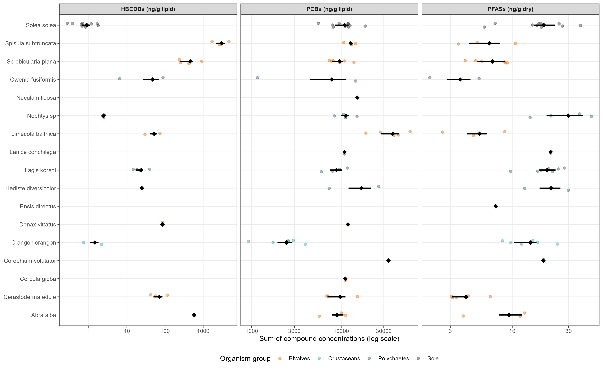
```

## HBCDD isomers contamination level profile

```{r fig-hbcdd-isomer-profiles, fig.cap="Relative contributions of α-, β- and γ-HBCDD to total HBCDD concentrations in juvenile common sole and benthic prey from the Seine estuary. Proportions were calculated using LOQ/2 substitution for concentrations below the limit of quantification and should therefore be interpreted as scenario-dependent estimates rather than directly observed isomeric profiles. Quantification frequencies differed markedly among isomers, particularly in juvenile soles, where β-HBCDD was entirely censored and γ-HBCDD was censored in nine of ten pools. Additional censoring treatments and analytical bounds are presented in the HBCDD-specific bounds table below. Concentrations are expressed on a total lipid-weight basis.", fig.show='hold'}
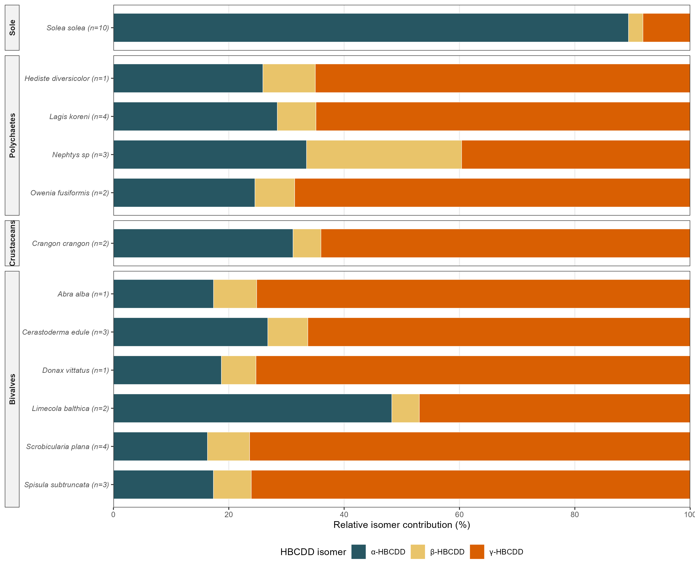
```

The HBCDD censoring treatments and analytical bounds are reported in Supplementary Table S\@ref(tab:tab-hbcdd-bounds).

<!---BLOCK_LANDSCAPE_START--->
## Best available taxonomic matching of prey in stomach content

```{r tbl-prey-masses, tab.id="tab-prey-masses", tab.cap="Taxonomic matching, data sources, and estimated individual ash-free dry weight (AFDW) of prey taxa identified in juvenile common sole (Solea solea) digestive tracts. Individual prey masses (mg ind⁻¹) were estimated using the {Btrait} package (v1.0.1) and Gogina et al. (2022). The number of reference taxa used for mass estimation is indicated by n. Match quality describes the level of supporting evidence for each estimate, while shared rank indicates the lowest taxonomic rank shared between the observed prey taxon and the reference taxa. Median, Q25 and Q75 represent the estimated median individual AFDW and its 25th and 75th percentiles, respectively.", fig.show='hold'}
mass_stats_matches |> 
  mutate(
    median = round(mass_median, digits = 2),
    Q25 = round(mass_minq25, digits = 2),
    Q75 = round(mass_maxq75, digits = 2)
    ) |> 
  rename("Observed species" = observed_species, 
         n = n_species, 
         "Match quality" = mass_match_quality,
         "Shared rank" = shared_rank) |> 
  select(-c(mass_iqr, mass_iqr_rel, mass_median, mass_minq25, mass_maxq75, priority, n_candidates, taxonomic_matching_quality)) |> 

flextable() |>
  theme_booktabs() |>
  set_table_properties(
    layout = "fixed",
    opts_word = list(
      split = TRUE,
      repeat_headers = TRUE
    )
  ) |>
  width(j = "Observed species", width = 1.60) |>
  width(j = "n", width = 0.35) |>
  width(j = "source", width = 2.30) |>
  width(j = "Match quality", width = 1.25) |>
  width(j = "Shared rank", width = 0.90) |>
  width(j = "median", width = 0.65) |>
  width(j = "Q25", width = 0.65) |>
  width(j = "Q75", width = 0.65) |>
  fontsize(size = 8, part = "all") |>
  padding(padding = 2, part = "all") |>
  bold(part = "header") |>
  italic(j = "Observed species", part = "body") |>
  paginate(init = FALSE, hdr_ftr = TRUE)

```
<!---BLOCK_LANDSCAPE_STOP--->

## Assessment of taxonomic correspondence between dietary prey and chemically analysed taxa

To evaluate the taxonomic representativeness of the benthic organisms analysed for contaminants, prey taxa identified in the digestive tracts of age-0 common sole (Solea solea) were compared with those included in the chemical dataset. Taxonomic correspondence was assessed using the recorded taxon names. Prey were classified as directly matched when an identical taxonomic designation was present in both datasets, or as unmatched when no identical designation was available. Because digestion frequently prevented prey identification to species level, identical taxonomic designations were not necessarily equivalent to species-level matches. Conversely, the absence of a direct match did not necessarily indicate that the corresponding organisms were absent from the chemically analysed assemblage.

For each dietary taxon, numerical contribution was calculated as its abundance relative to the total number of prey individuals recorded in digestive tracts. Biomass contribution was estimated by multiplying prey abundance by the corresponding literature-derived median individual mass, including the reference siphonal mass correction for bivalves, and dividing by the summed estimated biomass across dietary taxa with available mass estimates. Numerical and biomass contributions were then aggregated by phylum and taxonomic correspondence category. Coverage was expressed both as a percentage of the total reconstructed diet and as a percentage of the numerical or biomass contribution within each phylum.

This analysis was intended to characterise the degree of taxonomic correspondence underlying the phylum-level reconstruction of dietary contaminant concentrations, rather than to establish direct chemical representativeness of individual prey organisms.

```{r tbl-diet-matching, tab.id="tab-diet-matching", tab.cap="Taxonomic correspondence between prey identified in digestive tracts of age-0 common sole (Solea solea) and benthic taxa analysed for contaminants in the Seine estuary. Dietary taxa are classified according to the availability of an identical taxonomic designation in the chemical dataset (Direct) or the absence of such a designation (No specific match). Numerical and biomass contributions are expressed as percentages of the total reconstructed diet. Biomass proportions were calculated using literature-derived median individual prey masses, including the reference siphonal mass correction for bivalves. The absence of an identical taxonomic designation does not necessarily indicate that the prey taxon was absent from the chemical dataset, as some dietary organisms could only be identified at higher taxonomic ranks.", fig.show='hold'}
coverage_phylum |> 
flextable() |>
  flextable::set_table_properties(layout = "fixed") |> 
  bold(part = "header") |>
  flextable::set_table_properties(opts_word = list(split = TRUE, repeat_headers = TRUE)) |>
  flextable::fontsize(size = 8, part = "all") |>
  flextable::padding(padding = 2, part = "all") |>
  flextable::paginate(init = FALSE, hdr_ftr = TRUE)
```


## Sensitivity to the bivalve correction factor

```{r fig-siphon-diet, fig.cap="Sensitivity of dietary composition to the bivalve correction factor. Sensitivity of estimated prey biomass contributions to the assumed proportion of bivalve body mass represented by ingested siphonal tissues. The correction factor was varied from 2% to 5% of estimated individual bivalve mass. Lines represent the biomass-weighted dietary contribution of each prey phylum. The vertical dashed line indicates the reference correction factor of 3.75% used in the main analyses.", fig.show='hold'}
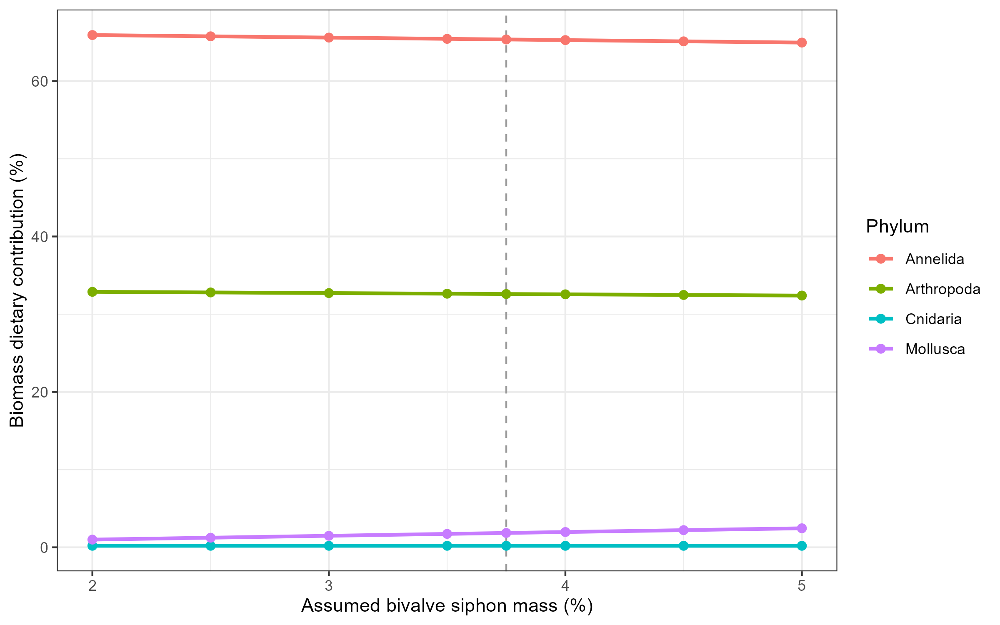
```


```{r fig-siphon-bmf, fig.cap="Sensitivity of biomass-weighted biomagnification factor (BMF) estimates to the assumed proportion of bivalve siphon mass in age-0 common sole (Solea solea) from the Seine estuary. The correction factor applied to estimated individual bivalve biomass was varied from 2% to 5%, while all other dietary parameters were held constant. Lines connect estimates for individual compounds, with HBCDD isomers labelled separately to facilitate interpretation. The vertical dotted line indicates the reference correction factor of 3.75% used in the main analyses, while the horizontal dashed line represents BMF = 1. BMF estimates were calculated using gamma-based MLE imputation, with LOQ/2 fallback when necessary, and are displayed on a logarithmic scale, with independent y-axis scales for each contaminant family.", fig.show='hold'}
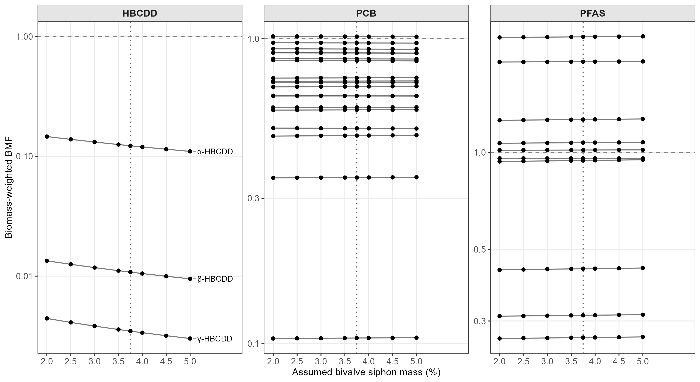
```

## Sensitivity of BMF estimates to numerical versus biomass weighting.

```{r fig-diet-weighting-delta, fig.cap="Effect of numerical versus biomass weighting on BMF estimates. Relative differences between biomass-weighted and numerically weighted biomagnification factor (BMF) estimates for individual PCB congeners, HBCDD isomers, and PFAS compounds. Differences are expressed as percentages relative to numerically weighted BMFs, calculated as 100 × (BMF_biomass / BMF_numeric − 1). Positive values indicate higher BMFs under biomass weighting, whereas negative values indicate higher BMFs under numerical weighting. Results correspond to the gamma-MLE scenario for censored concentrations.", fig.show='hold'}
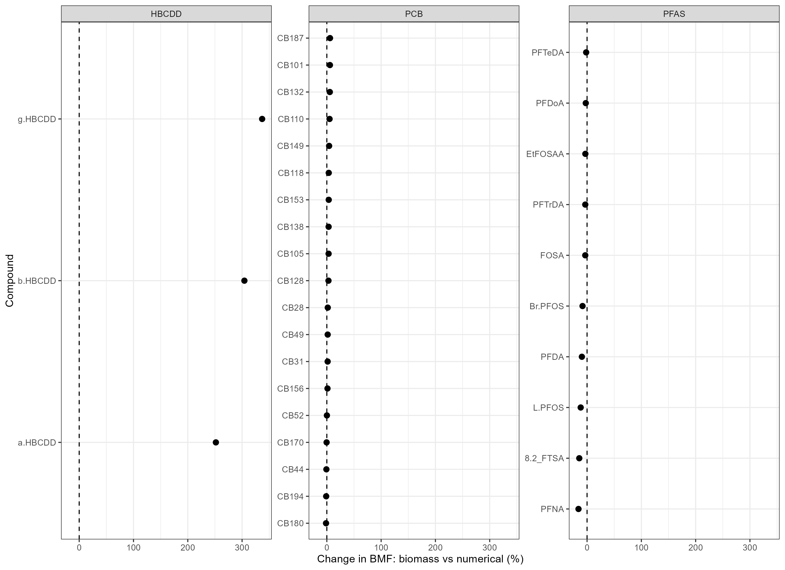
```


```{r fig-diet-weighting-sensitivity, fig.cap="Sensitivity to numerical versus biomass weighting. Compound-specific sensitivity of diet-based biomagnification factor (BMF) estimates to numerical versus biomass-based dietary weighting. Sensitivity was calculated as the median absolute log₂ ratio between biomass-weighted and numerically weighted BMF estimates. Results correspond to the gamma-based MLE scenario for censored concentrations, with LOQ/2 substitution used when distribution fitting was not feasible. Higher sensitivity values indicate greater differences between weighting approaches, irrespective of their direction. Multiplicative differences, calculated as 2 raised to the sensitivity value, are indicated alongside the bars. Results are presented separately for PCB congeners, HBCDD isomers, and PFAS compounds.", fig.show='hold'}
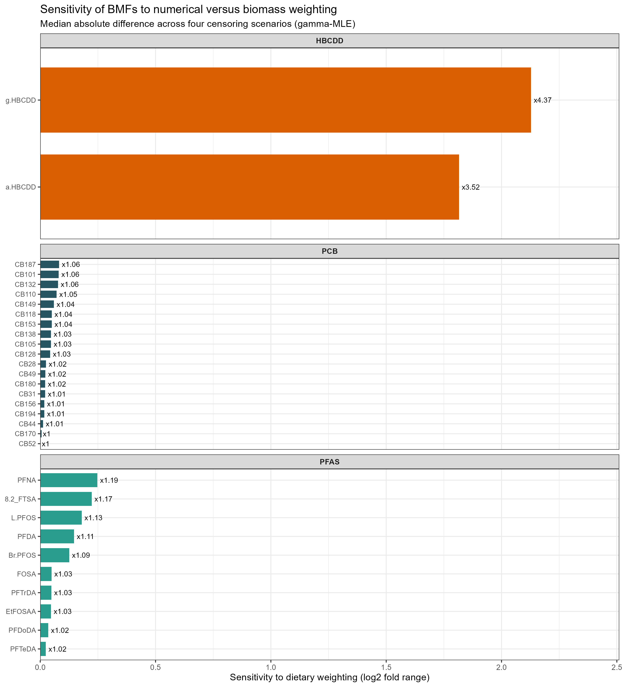
```


## Censoring audit

The censoring audit documented compound- and biological-group-specific censoring frequencies, limits of quantification, exclusion decisions and imputation outcomes. The 80% exclusion rule applied to PCB and PFAS compounds only; all three HBCDD isomers were retained as exploratory, biologically motivated exceptions, including those with 90–100% censored sole measurements. For retained compounds, gamma-based maximum-likelihood fitting was attempted separately for each compound and biological group when at least three observations, including two uncensored measurements, were available. Censored concentrations were imputed using their conditional expected values below the corresponding LOQs. When these data requirements were not met or model fitting failed, LOQ/2 substitution was applied as a fallback.

Of the 480 retained compound-by-biological-group combinations, 79 contained at least one censored observation. Gamma-based MLE fitting was successful for 36 combinations, whereas 43 required LOQ/2 fallback (21 with fewer than three observations and 22 with fewer than two uncensored measurements). The complete group-specific censoring and imputation audit, including model fitting diagnostics and imputed values, is provided in Supplementary Dataset S1.

```{r tbl-censor-audit, tab.id="tab-censor-audit", tab.cap="Compound-level left-censoring summary for autumn age-0 soles and benthic prey, including the documented HBCDD exception to the 80% exclusion criterion."}
source_table <- readr::read_csv("tables/Table_Sx_Censoring_summary.csv", show_col_types = FALSE)
flextable::flextable(source_table) |>
  flextable::theme_booktabs() |>
  flextable::set_table_properties(layout = "fixed") |> 
  flextable::set_table_properties(opts_word = list(split = TRUE, repeat_headers = TRUE)) |>
    fontsize(size = 8, part = "all") |>
  padding(padding = 2, part = "all") |>
  flextable::paginate(init = FALSE, hdr_ftr = TRUE)
```

## Sensitivity eligibility

```{r tbl-sensitivity-eligibility, tab.id="tab-sensitivity-eligibility", tab.cap="Eligibility of PCB congeners, HBCDD isomers and PFAS compounds for methodological sensitivity analyses based on log₂-ratios and zero-compatible bounded contrasts. The table reports the total number of retained compounds per chemical family and the numbers eligible or ineligible for each sensitivity metric. Log₂-based metrics require strictly positive BMF values across all 12 methodological combinations, whereas bounded contrasts allow finite, non-negative BMF values, including zero."}

sensitivity_family_eligibility <- read_csv(
  "tables/Table_Sx_Sensitivity_eligibility.csv",
  show_col_types = FALSE
)

sensitivity_family_eligibility |>
  select(
    Family = family,
    Compounds = n_compounds,
    `Log2 eligible` = n_log2_eligible,
    `Log2 not eligible` = n_log2_not_estimable,
    `Bounded eligible` = n_bounded_eligible
  ) |>
  flextable() |>
  theme_booktabs() |>
  flextable::set_table_properties(layout = "fixed")
```


```{r fig-zero-safe-sensitivity, fig.cap="Complementary zero-compatible methodological sensitivity of field-based biomagnification factors (BMFs). Dietary-weighting sensitivity (D_diet) and censoring sensitivity (D_censor) were calculated using bounded contrasts between maximum and minimum BMF estimates and summarised across methodological scenarios. Both indices range from 0 to 1. Symbols distinguish compounds eligible for the complete log2-based analysis from those containing zero BMF estimates. The dashed line indicates equal sensitivity to the two methodological factors. These indices represent deterministic methodological sensitivity, not statistical confidence intervals.", out.width="95%"}
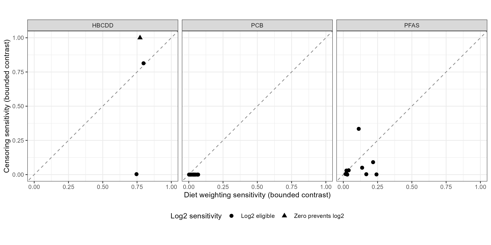
```

<!---BLOCK_LANDSCAPE_START--->
## HBCDD-specific censoring and BMF bounds

```{r tbl-hbcdd-bounds, tab.id="tab-hbcdd-bounds", tab.cap="HBCDD isomer-specific quantification frequencies, biomass-weighted field BMF estimates under four censoring treatments, and censoring-derived analytical bounds. Analytical bounds combine minimum predator and maximum diet concentrations for the lower ratio, and maximum predator and minimum diet concentrations for the upper ratio; they are not confidence intervals. The β- and γ-HBCDD estimates remain exploratory."}
hbcdd_table <- readr::read_csv("tables/Table_Sx_HBCDD_isomers_biomass.csv", show_col_types = FALSE)
hbcdd_table |>
  mutate(across(where(is.numeric), ~ round(.x, 3))) |>
  flextable::flextable() |>
  set_header_labels(
    `Soles quantified (n/N)` = "Sole n/N",
    `Prey quantified (n/N)` = "Prey n/N",
    `BMF gamma-MLE` = "BMF MLE",
    `Analytical lower bound` = "Lower bound",
    `Analytical upper bound` = "Upper bound",
    `Threshold interpretation` = "BMF vs 1"
  ) |>
  autofit() |>
  fit_columns(max_width = 8.8) |>
  theme_booktabs() |>
  fontsize(size = 7.5, part = "all")
```
<!---BLOCK_LANDSCAPE_STOP--->

## HBCDD quantification frequencies

```{r fig-hbcdd-detection, fig.cap="Quantification frequency of α-, β- and γ-HBCDD in juvenile sole and benthic prey. Labels show quantified/analysed sample counts; bars are based on observed detections only, with no concentration substitution."}
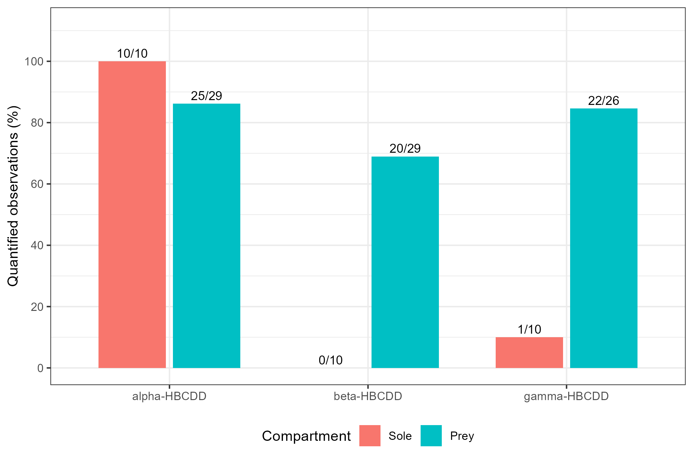
```

## HBCDD analytical BMF bounds

```{r fig-hbcdd-bounds, fig.cap="Censoring-derived lower and upper field BMF bounds for the three HBCDD isomers under equal, numerical and biomass weighting. Points give gamma-MLE ratios (with LOQ/2 fallback where needed); horizontal segments represent analytical bounds, not confidence intervals. The reference line denotes BMF = 1."}
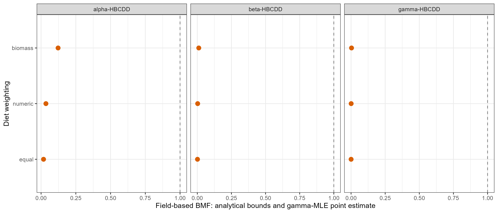
```

Supplementary Fig. S\@ref(fig:fig-hbcdd-bounds) places each BMF range relative to unity. Because the analytical bounds for all three HBCDD isomers are much smaller than one, their horizontal segments are difficult to distinguish on that scale. Supplementary Fig. S\@ref(fig:fig-hbcdd-bounds-zoom) displays the **same calculations**, with separate horizontal scales for each isomer. The intervals are derived from the minimum sole concentration divided by the maximum reconstructed dietary concentration, and the maximum sole concentration divided by the minimum reconstructed dietary concentration. They describe analytical censoring only, not confidence intervals. The reference values and exact bounds are provided in Supplementary Table S\@ref(tab:tab-hbcdd-bounds).

```{r fig-hbcdd-bounds-zoom, fig.cap="Zoomed representation of censoring-derived analytical BMF bounds for α-, β- and γ-HBCDD under equal, numerical and biomass-based dietary weighting. Points represent gamma-MLE estimates, including LOQ/2 fallback where model fitting was not feasible. Horizontal segments represent the range between the lower BMF bound (minimum predator concentration divided by maximum reconstructed dietary concentration) and the upper BMF bound (maximum predator concentration divided by minimum reconstructed dietary concentration). The horizontal scale differs among isomers to improve the visibility of these ranges; segment lengths should therefore not be compared visually across panels. The corresponding numerical values are reported in the HBCDD bounds table. Analytical bounds do not represent statistical confidence intervals.", echo=FALSE, out.width='100%'}
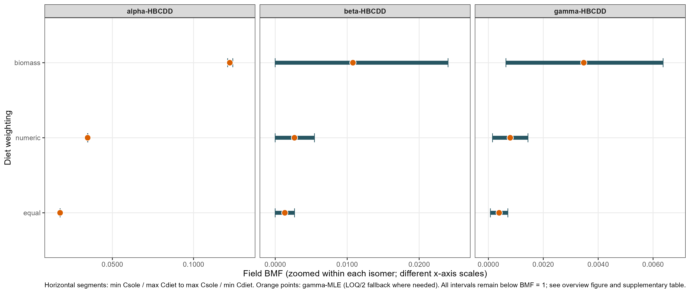
```

## Prey mass Q25–median–Q75 propagation to BMFs

```{r tbl-bmf-mass, tab.id="tab-bmf-mass", tab.cap="Sensitivity of biomass-weighted field-based normalised predator-to-diet concentration ratios to Q25, median and Q75 individual prey-mass estimates. Minimum and maximum BMF values were calculated across the three dietary reconstructions, without assuming a monotonic relationship between prey masses and BMFs. Multiplicative sensitivity ranges and changes in classification relative to unity are also reported. These values quantify deterministic sensitivity to alternative mass assumptions and should not be interpreted as confidence or credible intervals."}
mass_table <- readr::read_csv("tables/Table_Sx_BMF_mass_quantiles.csv", show_col_types = FALSE)
mass_table |>
  mutate(across(where(is.numeric), ~ round(.x, 3))) |>
  flextable::flextable() |>
  flextable::theme_booktabs() |>
  flextable::set_table_properties(layout = "fixed") |> 
  flextable::set_table_properties(opts_word = list(split = TRUE, repeat_headers = TRUE)) |>
  flextable::fontsize(size = 8, part = "all") |>
  flextable::padding(padding = 2, part = "all") |>
  flextable::paginate(init = FALSE, hdr_ftr = TRUE)
```

## Leave-one-chemically-analysed-prey-species-out sensitivity

To evaluate the influence of the chemical characterisation of individual benthic prey species on the reconstructed dietary denominator, one chemically analysed prey species was removed at a time. For each compound, species-level chemical concentrations were re-aggregated within phyla and biomass-weighted predator-to-diet concentration ratios were recalculated, holding the reference gamma-MLE censoring scenario and the dietary biomass weights fixed. Where removal eliminated the only chemically characterised species within a phylum, that phylum was omitted from the denominator and weights were renormalised over the remaining phyla. This analysis assesses the leverage of the analysed prey species on the chemical denominator, **not** uncertainty concerning the identity or abundance of prey actually consumed.

```{r tbl-loo-family, tab.id="tab-loo-family", tab.cap="Leave-one-chemically-analysed-prey-species-out sensitivity of biomass-weighted field-based normalised predator-to-diet concentration ratios, by contaminant family. A removal test is a compound-by-prey-species deletion. Classification changes refer to crossings of a ratio of one. Counts of affected compounds are distinct compounds and are not equivalent to numbers of removal tests."}
loo_family <- readr::read_csv("tables/Table_Sx_LOO_by_family.csv", show_col_types = FALSE)
loo_family |>
  dplyr::select(
    Family = family,
    `Compounds` = n_compounds,
    `Removal tests` = n_removal_tests,
    `Classification changes` = n_threshold_changes,
    `Compounds affected` = n_compounds_with_flip,
    `Entire phylum removed` = n_phylum_drops
  ) |>
  flextable::flextable() |>
  flextable::theme_booktabs() |>
  flextable::set_table_properties(layout = "fixed")
```

```{r fig-loo-species, fig.cap="Influence of individual chemically characterised benthic prey species on biomass-weighted field-based normalised predator-to-diet concentration ratios. Bars indicate the number of compound-by-species deletion tests that changed the classification relative to a concentration ratio of one. This leave-one-out analysis addresses the influence of measured prey chemistry, not uncertainty in the identity of prey consumed.", out.width="95%"}
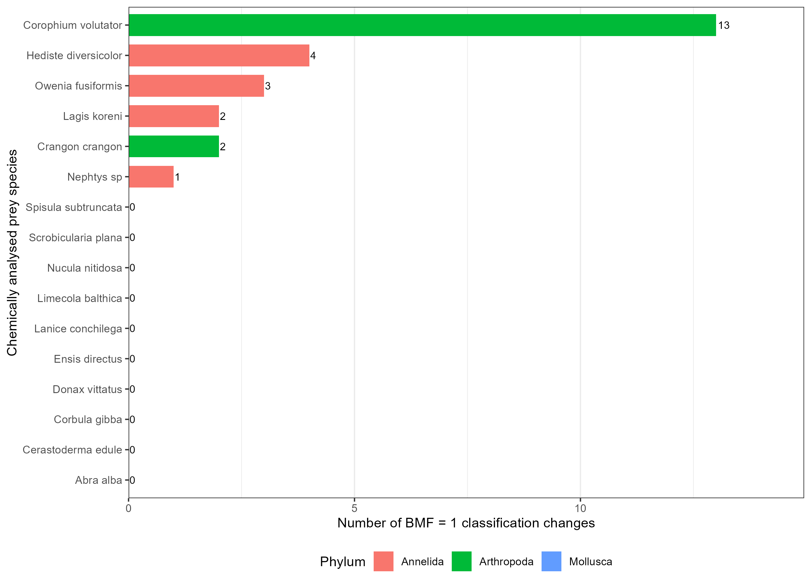
```

```{r fig-loo-compounds, fig.cap="Maximum absolute percentage change in reference gamma-MLE, biomass-weighted field-based predator-to-diet concentration ratios after deleting one chemically analysed prey species. Symbols distinguish compounds with at least one classification change across a ratio of one. Changes describe deterministic sensitivity to the species represented in the chemical dataset and are not confidence intervals.", out.width="95%"}
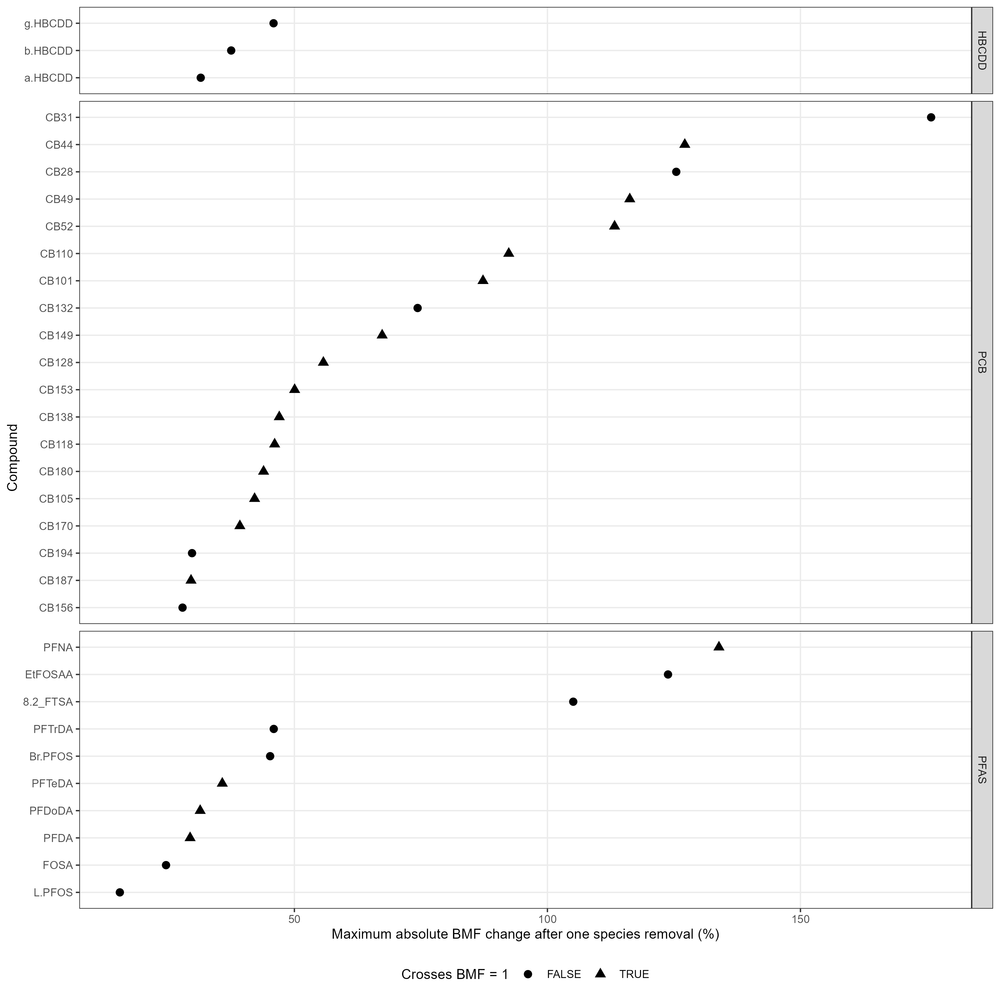
```

```{r tbl-loo-phylum, tab.id="tab-loo-phylum", tab.cap="Deletion tests in which removing one chemically analysed prey species also removed the final chemical representative of an entire phylum. The dietary denominator was then calculated using the remaining chemically represented phyla, with the original dietary weights renormalised; phylum removal does not imply its absence from juvenile sole stomach contents."}
loo_phylum <- readr::read_csv("tables/Table_Sx_LOO_phylum_drops.csv", show_col_types = FALSE)
loo_phylum |>
  dplyr::mutate(dplyr::across(c(bmf_reference, bmf_without_species),
                              ~ round(.x, 4)),
                delta_pct = round(delta_pct, 1)) |>
  dplyr::select(family, compound_name, removed_species, removed_phylum,
                bmf_reference, bmf_without_species, delta_pct, threshold_change) |>
  flextable::flextable() |>
  flextable::theme_booktabs() |>
  flextable::fontsize(size = 8, part = "all") |>
  flextable::padding(padding = 2, part = "all") |>
  flextable::set_table_properties(layout = "fixed")
```

Full compound-level and prey-species summaries are available in `Table_Sx_LOO_by_compound.csv` and `Table_Sx_LOO_species_influence.csv`, respectively, in the supplementary data package.

## Exploratory sensitivity to season-restricted prey chemistry

To explore the influence of the temporal coverage of prey chemistry on reconstructed dietary concentrations, field-based BMF estimates were recalculated using spring-only and autumn-only benthic chemical observations and compared with the reference estimates obtained by pooling both seasons. Predator concentrations, dietary biomass weights and the gamma-MLE imputations estimated from the complete dataset were held fixed.

These comparisons constitute descriptive sensitivity scenarios rather than a formal assessment of seasonal effects, because sampling effort, chemically characterised prey species and taxonomic coverage differed between the two seasonal subsets.


```{r tbl-prey-season, tab.id="tab-prey-season", tab.cap="Exploratory sensitivity of biomass-weighted field-based BMF estimates to the seasonal subset of benthic prey chemistry. Changes refer to classification relative to a BMF of one compared with the pooled-season reference. Prey species and analytical pool counts are compound-specific and may vary within a family. Dietary weight coverage represents the sum of reference biomass weights for chemically represented phyla. All comparisons use the full-dataset gamma-MLE imputations and fixed autumn predator concentrations and dietary weights; they do not isolate causal seasonal effects.", echo=FALSE, message=FALSE, warning=FALSE}

library(dplyr)
library(readr)
library(flextable)

season_summary <- read_csv(
  "tables/Table_Sx_prey_season_sensitivity.csv",
  show_col_types = FALSE
)

format_range <- function(lo, hi, digits = 0) {
  a <- sprintf(paste0("%.", digits, "f"), lo)
  b <- sprintf(paste0("%.", digits, "f"), hi)
  ifelse(a == b, a, paste0(a, "–", b))
}

season_table <- season_summary |>
  mutate(
    family = factor(family, levels = c("PCB", "PFAS", "HBCDD")),
    season = factor(season, levels = c("autumn", "spring")),
    species_pools = paste0(
      format_range(n_species_min, n_species_max),
      " (",
      format_range(n_pools_min, n_pools_max),
      ")"
    ),
    phyla = format_range(n_phyla_min, n_phyla_max),
    coverage = format_range(
      100 * weight_coverage_min,
      100 * weight_coverage_max,
      digits = 1
    )
  ) |>
  arrange(family, season) |>
  transmute(
    Family = as.character(family),
    Season = tools::toTitleCase(as.character(season)),
    Compounds = n_compounds,
    `Class changes` = n_class_changes,
    `Species (pools)` = species_pools,
    Phyla = phyla,
    `Diet covered (%)` = coverage
  )

season_table |>
  flextable() |>
  theme_booktabs() |>
  set_table_properties(layout = "fixed") |>
  width(j = "Family", width = 0.65) |>
  width(j = "Season", width = 0.75) |>
  width(j = "Compounds", width = 0.75) |>
  width(j = "Class changes", width = 0.85) |>
  width(j = "Species (pools)", width = 1.50) |>
  width(j = "Phyla", width = 0.50) |>
  width(j = "Diet covered (%)", width = 1.10) |>
  fontsize(size = 8, part = "all") |>
  padding(padding = 3, part = "all") |>
  bold(part = "header") |>
  align(
    j = c("Compounds", "Class changes", "Phyla"),
    align = "center",
    part = "all"
  )
```


## BMF sensitivity ranges arising from prey masses

```{r fig-bmf-mass-ranges, fig.cap="Sensitivity of biomass-weighted field-based normalised predator-to-diet concentration ratios (operational BMF estimates) to alternative individual prey-mass assumptions. Points represent BMF estimates obtained using median reference masses, whereas horizontal segments extend from the minimum to the maximum values obtained across the Q25, median and Q75 dietary reconstructions. These extrema do not necessarily correspond to the Q25 and Q75 mass scenarios, respectively. The dashed vertical line indicates a concentration ratio of one. The segments represent deterministic sensitivity ranges, not confidence or credible intervals."}
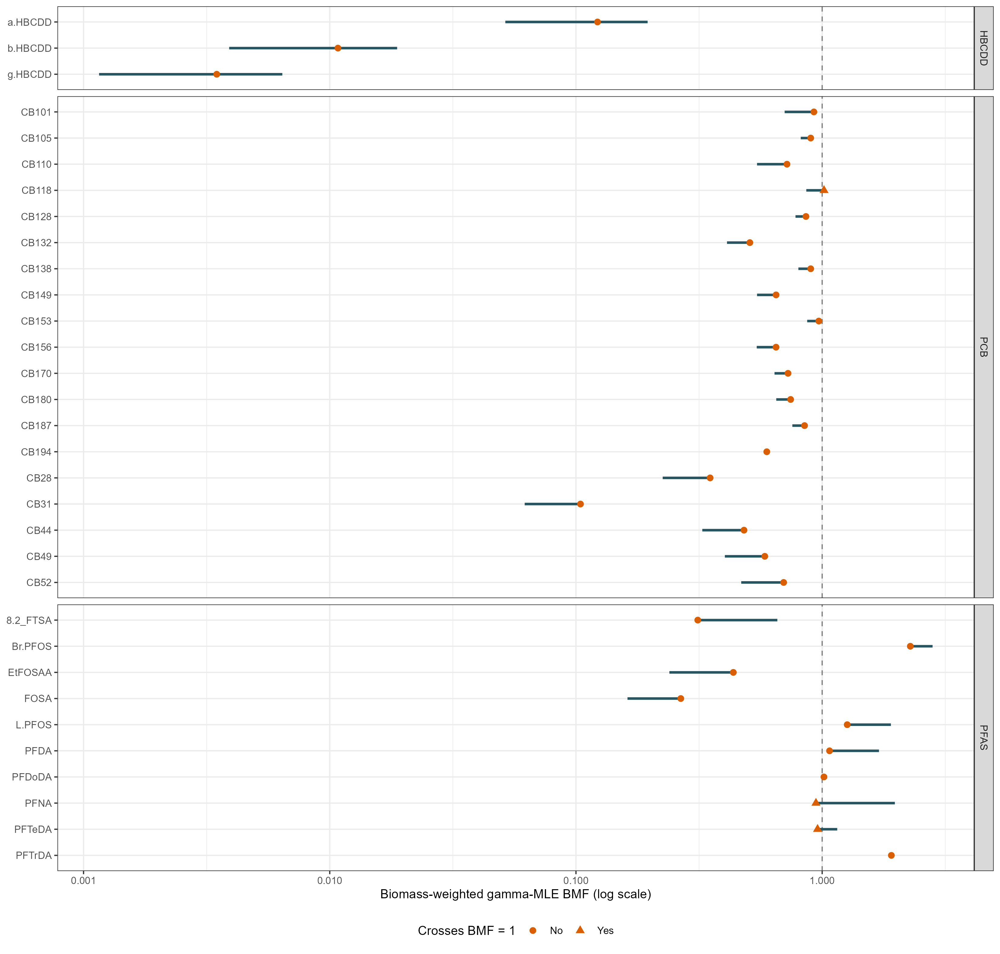
```

## Threshold-sensitive compounds under prey-mass assumptions

```{r fig-bmf-mass-crossings, fig.cap="Variation in biomass-weighted field-based normalised predator-to-diet concentration ratios across Q25, median and Q75 individual prey-mass scenarios for compounds whose estimated ratios cross unity. Each scenario applies the corresponding mass estimates simultaneously across prey taxa. The dashed horizontal line indicates a concentration ratio of one. These scenario-based differences do not represent statistical confidence or credible intervals.", eval=file.exists("figures/Fig.S_mass_quantile_threshold_sensitive.png")}
path <- "figures/Fig.S_mass_quantile_threshold_sensitive.png"
knitr::include_graphics(path)
```
